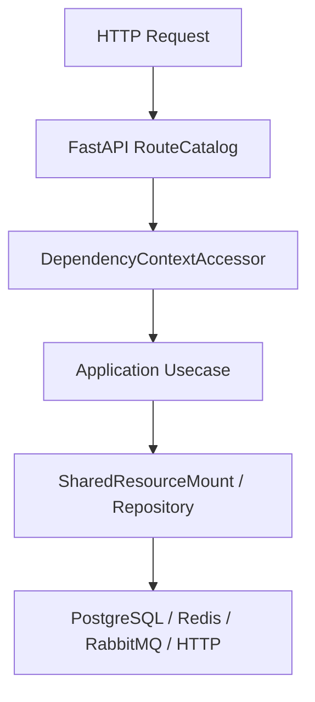

# Repository 模式

## 1. 文档目的
说明仓储实现如何配合 UnitOfWork。

**最后更新范围**：覆盖当前 ORM、Alembic、repository 和数据库运行时配置。

## 2. 适用读者
- 新人开发者
- 后端开发者
- 测试维护者
- 运维部署人员

## 3. 关联源码
| 路径 | 作用 |
| --- | --- |
| `src/infrastructure/persistence/orm_model` | ORM 模型。 |
| `src/infrastructure/persistence/alembic/versions` | 迁移版本。 |
| `src/infrastructure/persistence/repository_impl` | 仓储实现。 |
| `src/infrastructure/persistence/sqlalchemy_session_factory.py` | UnitOfWork。 |
| `config/runtime/database_runtime` | 数据库配置。 |

## 4. 核心结论
- 当前持久化表共 25 张：基础身份、日志、任务、安全与密钥环 11 张，Codex 控制面 14 张。
- Alembic 版本链从 `202605151600` 到 `202609291900`；当前 head 为 `202609291900`。
- 事务边界通过 `SqlAlchemyUnitOfWork` 控制。

## 5. 结构说明
数据层由 SQLAlchemy engine/session/UnitOfWork、ORM 模型、repository 实现和 Alembic 迁移组成。

## 6. 工作流程

## 7. 关键实现
| 组件 | 文件 | 职责 |
| --- | --- | --- |
| `SqlAlchemyEngineFactory` | `src/infrastructure/persistence/sqlalchemy_engine_factory.py` | 创建 engine。 |
| `SqlAlchemyUnitOfWork` | `src/infrastructure/persistence/sqlalchemy_session_factory.py` | 事务工作单元。 |
| `AlembicRunner.upgrade_head` | `src/infrastructure/persistence/alembic_runner.py` | 执行迁移。 |

## 8. 如何修改或扩展
1. 新增表先写 ORM 模型。
2. 新增 Alembic migration 并维护 down_revision。
3. 新增 repository 或扩展现有实现。
4. 补数据层 unit/integration 测试。
5. 同步本数据文档和 API/用例文档。

## 9. 测试覆盖
| 测试类型 | 文件 | 验证内容 |
| --- | --- | --- |
| integration | `test/integration_test/test_migration_job_integration.py` | 迁移。 |
| unit | `test/unit_test/test_task_execution_record_repository_unit.py` | 任务记录仓储。 |
| integration | `test/integration_test/test_task_execution_record_integration.py` | 任务记录集成。 |

## 10. 常见问题
- 如果 ORM 与 migration 不一致，优先以当前 ORM 和 Alembic 版本文件为准，历史方案只作参考。

## 11. 维护备注
数据模型变更必须同步 ORM、migration、repository、测试和本说明书。

### 当前表与模型对应

| 表 | ORM 模型 | 迁移来源 |
| --- | --- | --- |
| `auth_user` | `AuthUserOrmModel` | `202605151600_create_auth_tables.py` |
| `auth_role` | `AuthRoleOrmModel` | `202605151600_create_auth_tables.py` |
| `auth_user_role` | `AuthUserRoleOrmModel` | `202605151600_create_auth_tables.py` |
| `auth_user_scope` | `AuthUserScopeOrmModel` | `202608101100_add_auth_user_scope.py` |
| `auth_role_scope` | `AuthRoleScopeOrmModel` | `202605151600_create_auth_tables.py` + `202605291041_fix_identity_task_schema_drift.py` |
| `auth_refresh_token` | `AuthRefreshTokenOrmModel` | `202605151600_create_auth_tables.py` + `202605251640_harden_refresh_token_constraints.py` |
| `auth_scope` | `AuthScopeOrmModel` | `202605271330_create_auth_scope_catalog.py` |
| `app_log_record` | `AppLogRecordOrmModel` | `202605181039_create_app_log_record_table.py` + `202605291041_fix_identity_task_schema_drift.py` |
| `task_execution_record` | `TaskExecutionRecordOrmModel` | `202605221609_create_task_execution_record_table.py` + `202605231821_add_task_execution_backend.py` + `202605291041_fix_identity_task_schema_drift.py` |
| `task_execution_outbox` | `TaskExecutionOutboxOrmModel` | `202607021200_add_task_execution_published_at.py` |
| `security_ip_block_record` | `SecurityIpBlockRecordOrmModel` | `202605260859_create_security_ip_block_record.py` |
| `key_ring_snapshot` | `KeyRingSnapshotOrmModel` | `202607051000_create_key_ring_snapshot.py` |
| `codex_host` | `CodexHostOrmModel` | `202607311200_create_codex_control_phase1.py` + `202608081000_add_codex_host_compatibility.py` + `202608101000_harden_codex_device_ownership.py` |
| `codex_agent_credential` | `CodexAgentCredentialOrmModel` | `202607311200_create_codex_control_phase1.py` |
| `codex_workspace` | `CodexWorkspaceOrmModel` | `202607311200_create_codex_control_phase1.py` + `202608071400_add_codex_workspace_worktree_policy.py` + `202608151820_unify_codex_conversation_index.py` |
| `codex_thread_index` | `CodexThreadIndexOrmModel` | `202607311200_create_codex_control_phase1.py` + `202608151820_unify_codex_conversation_index.py` + `202608151940_normalize_codex_thread_status.py` |
| `codex_control_operation` | `CodexControlOperationOrmModel` | `202607311200_create_codex_control_phase1.py` + `202608161230_add_codex_operation_projection.py` |
| `codex_approval_audit` | `CodexApprovalAuditOrmModel` | `202607311200_create_codex_control_phase1.py` + `202608101300_repair_codex_approval_runtime_state.py` |
| `codex_host_device_key` | `CodexHostDeviceKeyOrmModel` | `202608071200_add_codex_device_identity.py` |
| `codex_device_authorization_audit` | `CodexDeviceAuthorizationAuditOrmModel` | `202608071200_add_codex_device_identity.py` |
| `codex_command_outbox` | `CodexCommandOutboxOrmModel` | `202608071300_add_codex_command_outbox.py` |

### 当前仓储实现核对

| 仓储实现 | 主要表 | 事务说明 |
| --- | --- | --- |
| `AuthIdentityRepositoryImpl` | `auth_user`、`auth_role`、`auth_user_role`、`auth_role_scope`、`auth_scope` | 查询身份/授权快照，scope 缺失或禁用时 fail-closed；更新密码只执行 SQL，不自行提交。 |
| `AdminIdentityRepositoryImpl` | 身份/RBAC 全部表 | 负责 scope、角色、用户管理；关键变更用 `LOCK TABLE auth_user IN SHARE ROW EXCLUSIVE MODE` 维护 active admin + `auth:manage` 不变量。 |
| `RefreshTokenRepositoryImpl` | `auth_refresh_token` | 创建、轮换、撤销与会话状态查询；批量撤销会先 flush，再执行 update 并 `expire_all()`。 |
| `TaskExecutionRecordRepositoryImpl` | `task_execution_record` | `upsert()` 只执行写入和 flush，不开启 nested transaction；去重唯一约束冲突交由 `TaskExecutionStore` 在 UnitOfWork 边界处理并回查已有记录。 |
| `LogRecordRepositoryImpl` | `app_log_record` | 批量写入日志，支持按 level、event_kind、request/trace、时间范围和 JSONB 内安全事件字段过滤。 |
| `SecurityIpBlockRepository` | `security_ip_block_record` | 查询有效封禁、创建封禁、释放封禁；方法内只 flush/execute，不负责最终提交。 |
| `RuntimeStateRepositoryImpl` | 无业务表 | 仅通过 `SELECT 1` 探活。 |
| Codex repository implementations | 9 张 Codex 表 | host/workspace/thread/operation/approval/device/outbox 按 owner 与稳定 ID 读写；只 flush，不自行提交，claim 使用行锁或 `SKIP LOCKED`。 |

### 仓储边界约定

- 主要仓储实现统一继承 `Repository` 并暴露 `ping()` 探活，包括身份、刷新令牌、日志、任务执行记录、任务 outbox、IP 封禁和运行时状态仓储。
- 仓储接收外部传入的 `PersistenceSession` 协议对象，由 `SharedResourceMount` 或 `SharedDbSessionManager` 根据 `UnitOfWork.get_session()` 注入；当前基础设施实现可在协议背后使用 SQLAlchemy 会话，但 core 契约不暴露 ORM Session。
- 仓储方法可以 `add()`、`flush()`、`execute()` 或 `expire_all()`，但不拥有顶层事务的 commit/rollback，也不在仓储内部开启 nested transaction；提交与回滚由用例、任务存储、日志写入器或安全防护流程的 UnitOfWork 统一处理。
- `TaskExecutionRecordRepositoryImpl` 只吞掉 `uq_task_execution_record_job_kind_deduplication_key` 对应的幂等冲突；`uq_task_execution_record_record_id` 等其他完整性异常会向外抛出。
- Codex command outbox claim、审批 claim 和设备授权审计都由调用方持有 UnitOfWork；repository 不发布 Redis 通知、不解密 payload，也不关闭共享连接。

## 12. 相关文档
- [项目文档总览](../README.md)
- [新增迁移](../09_development_guide/adding_new_migration.md)
