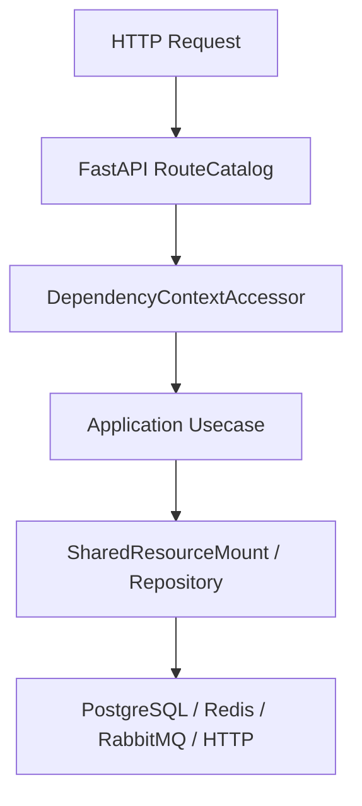

# 事务边界

## 1. 文档目的
说明 commit/rollback/dispose 如何被用例和资源门面使用。

**最后更新范围**：覆盖当前 ORM、Alembic、repository 和数据库运行时配置。

## 2. 适用读者
- 新人开发者
- 后端开发者
- 测试维护者
- 运维部署人员

## 3. 关联源码
| 路径 | 作用 |
| --- | --- |
| `src/infrastructure/persistence/orm_model` | ORM 模型。 |
| `src/infrastructure/persistence/alembic/versions` | 迁移版本。 |
| `src/infrastructure/persistence/repository_impl` | 仓储实现。 |
| `src/infrastructure/persistence/sqlalchemy_session_factory.py` | UnitOfWork。 |
| `config/runtime/database_runtime` | 数据库配置。 |

## 4. 核心结论
- 当前持久化表共 25 张：基础身份、日志、任务、安全与密钥环 11 张，Codex 控制面 14 张。
- Alembic 版本链从 `202605151600` 到 `202609291900`；当前 head 为 `202609291900`。
- 事务边界通过 `SqlAlchemyUnitOfWork` 控制。

## 5. 结构说明
数据层由 SQLAlchemy engine/session/UnitOfWork、ORM 模型、repository 实现和 Alembic 迁移组成。

## 6. 工作流程

## 7. 关键实现
| 组件 | 文件 | 职责 |
| --- | --- | --- |
| `SqlAlchemyEngineFactory` | `src/infrastructure/persistence/sqlalchemy_engine_factory.py` | 创建 engine。 |
| `SqlAlchemyUnitOfWork` | `src/infrastructure/persistence/sqlalchemy_session_factory.py` | 事务工作单元。 |
| `AlembicRunner.upgrade_head` | `src/infrastructure/persistence/alembic_runner.py` | 执行迁移。 |

## 8. 如何修改或扩展
1. 新增表先写 ORM 模型。
2. 新增 Alembic migration 并维护 down_revision。
3. 新增 repository 或扩展现有实现。
4. 补数据层 unit/integration 测试。
5. 同步本数据文档和 API/用例文档。

## 9. 测试覆盖
| 测试类型 | 文件 | 验证内容 |
| --- | --- | --- |
| integration | `test/integration_test/test_migration_job_integration.py` | 迁移。 |
| unit | `test/unit_test/test_task_execution_record_repository_unit.py` | 任务记录仓储。 |
| integration | `test/integration_test/test_task_execution_record_integration.py` | 任务记录集成。 |

## 10. 常见问题
- 如果 ORM 与 migration 不一致，优先以当前 ORM 和 Alembic 版本文件为准，历史方案只作参考。

## 11. 维护备注
数据模型变更必须同步 ORM、migration、repository、测试和本说明书。

### 当前表与模型对应

| 表 | ORM 模型 | 迁移来源 |
| --- | --- | --- |
| `auth_user` | `AuthUserOrmModel` | `202605151600_create_auth_tables.py` |
| `auth_role` | `AuthRoleOrmModel` | `202605151600_create_auth_tables.py` |
| `auth_user_role` | `AuthUserRoleOrmModel` | `202605151600_create_auth_tables.py` |
| `auth_user_scope` | `AuthUserScopeOrmModel` | `202608101100_add_auth_user_scope.py` |
| `auth_role_scope` | `AuthRoleScopeOrmModel` | `202605151600_create_auth_tables.py` + `202605291041_fix_identity_task_schema_drift.py` |
| `auth_refresh_token` | `AuthRefreshTokenOrmModel` | `202605151600_create_auth_tables.py` + `202605251640_harden_refresh_token_constraints.py` |
| `auth_scope` | `AuthScopeOrmModel` | `202605271330_create_auth_scope_catalog.py` |
| `app_log_record` | `AppLogRecordOrmModel` | `202605181039_create_app_log_record_table.py` + `202605291041_fix_identity_task_schema_drift.py` |
| `task_execution_record` | `TaskExecutionRecordOrmModel` | `202605221609_create_task_execution_record_table.py` + `202605231821_add_task_execution_backend.py` + `202605291041_fix_identity_task_schema_drift.py` |
| `task_execution_outbox` | `TaskExecutionOutboxOrmModel` | `202607021200_add_task_execution_published_at.py` |
| `security_ip_block_record` | `SecurityIpBlockRecordOrmModel` | `202605260859_create_security_ip_block_record.py` |
| `key_ring_snapshot` | `KeyRingSnapshotOrmModel` | `202607051000_create_key_ring_snapshot.py` |
| `codex_host` | `CodexHostOrmModel` | `202607311200_create_codex_control_phase1.py` + `202608081000_add_codex_host_compatibility.py` + `202608101000_harden_codex_device_ownership.py` |
| `codex_agent_credential` | `CodexAgentCredentialOrmModel` | `202607311200_create_codex_control_phase1.py` |
| `codex_workspace` | `CodexWorkspaceOrmModel` | `202607311200_create_codex_control_phase1.py` + `202608071400_add_codex_workspace_worktree_policy.py` + `202608151820_unify_codex_conversation_index.py` |
| `codex_thread_index` | `CodexThreadIndexOrmModel` | `202607311200_create_codex_control_phase1.py` + `202608151820_unify_codex_conversation_index.py` + `202608151940_normalize_codex_thread_status.py` |
| `codex_control_operation` | `CodexControlOperationOrmModel` | `202607311200_create_codex_control_phase1.py` + `202608161230_add_codex_operation_projection.py` |
| `codex_approval_audit` | `CodexApprovalAuditOrmModel` | `202607311200_create_codex_control_phase1.py` + `202608101300_repair_codex_approval_runtime_state.py` |
| `codex_host_device_key` | `CodexHostDeviceKeyOrmModel` | `202608071200_add_codex_device_identity.py` |
| `codex_device_authorization_audit` | `CodexDeviceAuthorizationAuditOrmModel` | `202608071200_add_codex_device_identity.py` |
| `codex_command_outbox` | `CodexCommandOutboxOrmModel` | `202608071300_add_codex_command_outbox.py` |

### 事务边界核对

- `SqlAlchemySessionFactory` 使用 `sessionmaker(bind=engine, autoflush=False, autocommit=False, expire_on_commit=False, future=True)` 创建 session；因此写入需要显式 `flush()` 或 `commit()`。
- `SqlAlchemyUnitOfWork` 是当前顶层事务边界，暴露 `get_session()`、`flush()`、`commit()`、`rollback()`、`dispose()`；`dispose()` 关闭 session，`dispose_engine()` 释放 engine。
- `SharedDbSessionManager.create_unit_of_work()` 直接转调 `SqlAlchemySessionFactory.create_unit_of_work()`；`SharedResourceMount.create_unit_of_work()` 再把它暴露给应用用例和基础设施流程。
- 鉴权用例 `issue_access_token_usecase.py`、`refresh_access_token_usecase.py`、`revoke_access_token_usecase.py` 都在 try/except/finally 中显式 commit/rollback/dispose。
- 基础设施流程也各自管理事务：`DatabaseLogWriter` 写库日志后 commit/异常 rollback，`TaskExecutionStore` 在预占和状态变更时提交，`IpBlockGuard` 在封禁/释放流程中提交或回滚。
- 仓储层不拥有顶层事务，也不再在仓储内部开启 `session.begin_nested()`；任务去重唯一键冲突由 `TaskExecutionStore` 在 UnitOfWork 边界捕获 `IntegrityError` 后开启新的读取流程回查既有记录。
- 管理员身份仓储在会影响管理员可用性的变更前锁定 `auth_user` 表，并在同一 UnitOfWork 内检查 active admin + `auth:manage` 不变量。
- `ManageCodexApprovalUsecase` 在同一 UnitOfWork 内 claim approval、创建稳定 operation 并写入加密 command outbox；任一写入失败都会 rollback，提交后才触发 Agent dispatch。
- Agent v2 的 `executing` ACK 表示审批副作用已经由 Agent 应用，因此审批和 operation 可进入 applied/completed；其他命令仍按自身 ACK 状态机处理，不能把该语义泛化为所有任务完成。

### 事务测试核对

- `test/unit_test/test_task_execution_record_repository_unit.py` 与任务存储测试验证去重冲突不由仓储私自提交/回滚，非去重唯一约束继续向外抛出。
- `test/integration_test/test_task_execution_record_integration.py` 验证并发预占同一去重键时只创建一条记录，迁移后的 PostgreSQL schema 同样成立。
- `test/unit_test/test_auth_persistence_unit.py` 与 admin identity 相关测试验证 scope 禁用 fail-closed、刷新令牌状态一致性，以及回滚/提交后数据状态符合预期。

## 12. 相关文档
- [项目文档总览](../README.md)
- [新增迁移](../09_development_guide/adding_new_migration.md)
