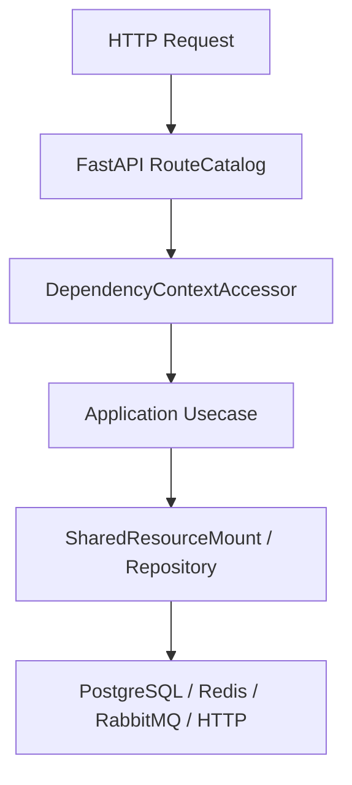

# 如何新增测试

## 1. 文档目的
说明按风险选择测试层级的步骤。

**最后更新范围**：覆盖 `test` 目录、`pyproject.toml` pytest 配置和 `src/infrastructure/testing` 测试支持。

## 2. 适用读者
- 测试维护者
- 后端开发者
- 新人开发者

## 3. 关联源码
| 路径 | 作用 |
| --- | --- |
| `pyproject.toml` | `pythonpath = ['.']`，`testpaths = ['test']`。 |
| `test/unit_test` | 单元测试。 |
| `test/contract_test` | 契约测试。 |
| `test/interface_test` | HTTP 接口测试。 |
| `test/integration_test` | 集成测试。 |
| `src/infrastructure/testing` | fake/test support，仅测试用途。 |

## 4. 核心结论
- 测试分层覆盖 unit、contract、interface、integration、boundary、exception、initialization、path、convention_usage、class_inheritance。
- `test/conftest.py` 会设置 `APP_ENV=test`、测试数据库 URL、测试 JWT_SECRET 和 bootstrap password。
- PostgreSQL、Redis、RabbitMQ 或 Docker 前置条件不可达时测试失败，阶段证据记为 `blocked`；不得以 skip/xfail 形成绿色回归。
- fake/test support 只用于测试，不应进入生产装配。
- 本项目优先使用项目解释器执行测试：`.\.venv\Scripts\python.exe -m pytest -q`。

## 5. 结构说明
测试目录按风险面拆分：纯逻辑用 unit，模型约束用 contract，HTTP 行为用 interface，外部组件用 integration，启动和异常路径分别有独立层。

## 6. 工作流程

## 7. 关键实现
| 组件 | 文件 | 职责 |
| --- | --- | --- |
| `DatabaseResetPolicy` | `test/conftest.py` | 测试数据库重置策略。 |
| `RedisIntegrationAvailability.fail_when_unavailable` | `test/redis_integration_support.py` | Redis 不可达时让真实依赖回归失败。 |
| `TestAppFactory` | `src/api/testing/test_app_factory.py` | 测试应用工厂。 |

## 8. 如何修改或扩展
1. 定位改动影响层级。
2. 先补最窄 unit/contract 测试。
3. 若改 HTTP 表面，补 interface 测试。
4. 若改 PostgreSQL/Redis/RabbitMQ/Funboost，补显式 marker 的 integration 测试；缺少前置条件时保留失败和 `blocked` 证据。
5. 更新对应文档中的测试覆盖表。
6. 运行 `.\.venv\Scripts\python.exe -m pytest -q`；若只跑最小失败集，也要在交付说明里标明范围。

## 9. 测试覆盖
| 测试类型 | 文件 | 验证内容 |
| --- | --- | --- |
| unit | `test/unit_test/test_fastapi_app_assembler_unit.py` | 装配器。 |
| contract | `test/contract_test/test_task_registration_contract.py` | 任务注册契约。 |
| interface | `test/interface_test/test_admin_task_interface.py` | 任务接口。 |
| integration | `test/integration_test/test_funboost_rabbitmq_integration.py` | RabbitMQ/funboost。 |

## 10. 常见问题
- 如果测试误连开发库，检查 `TEST_DATABASE_URL` 和 `TEST_DATABASE_RESET`。

## 11. 维护备注
新增测试层级或测试支持工具时，同步测试目录地图和开发指南。

### 测试目录索引

| 目录 | 用途 | 代表文件 |
| --- | --- | --- |
| `test/unit_test` | 纯逻辑和装配单元。 | `test_fastapi_app_assembler_unit.py` |
| `test/contract_test` | Pydantic/core contract。 | `test_http_contract.py` |
| `test/interface_test` | HTTP 接口表面。 | `test_admin_task_interface.py` |
| `test/integration_test` | 数据库、Redis、RabbitMQ 等外部组件。 | `test_funboost_rabbitmq_integration.py` |
| `test/boundary_test` | 边界条件。 | `test_hard_migration_module_boundary.py` |
| `test/exception_test` | 异常路径。 | `test_security_exception.py` |
| `test/initialization_test` | 启动初始化。 | `test_runtime_initialization.py` |
| `test/path_test` | 主路径/目录约定。 | `test_web_execution_path.py` |
| `test/convention_usage_test` | 用法约定。 | `test_end_to_end_usage.py` |
| `test/class_inheritance_test` | 运行时契约继承关系。 | `test_runtime_contract_inheritance.py` |

## 12. 相关文档
- [项目文档总览](../README.md)
- [测试规范](../../standard/测试规范.md)

## 13. 当前新增测试落点（2026-06-22）

新增测试时按变更影响面选择最窄目录，并保持文件命名与现有后缀一致：`*_unit.py`、`*_contract.py`、`*_interface.py`、`*_integration.py`、`*_boundary.py`、`*_exception.py`、`*_path.py`、`*_initialization.py`。

| 变更类型 | 优先落点 | 说明 |
| --- | --- | --- |
| 纯逻辑、用例编排、端口适配、装配器、配置解析局部规则 | `test/unit_test` | 可复用 `src/infrastructure/testing` fake/test support，避免真实外部服务。 |
| Pydantic/schema、端口协议、返回 envelope、业务边界契约 | `test/contract_test` | 管理端身份和审计已有子目录，可按领域继续归档。 |
| 路由、状态码、鉴权、依赖注入、响应体、限流/指标 HTTP 表面 | `test/interface_test` | 使用 `TestClient` 和 `TestAppFactory` 覆盖真实 HTTP 表面。 |
| PostgreSQL、Redis、RabbitMQ/Funboost、迁移、生产配置、RBAC 端到端链路 | `test/integration_test` | Redis 用 `RedisIntegrationAvailability.fail_when_unavailable(...)`；RabbitMQ/Funboost 直接检查真实 broker。 |
| 极值、非法值、上限下限、payload 大小、TTL、节流窗口 | `test/boundary_test` | 断言边界语义，不把普通 happy path 放入这里。 |
| 异常转换、故障注入、脱敏、fail-open/fail-closed | `test/exception_test` | 以异常类型、HTTP fault 和安全响应为断言重点。 |
| 主链路、配置重载、资源热切换、开发骨架路径 | `test/path_test` | 覆盖跨组件但不一定依赖真实外部服务的路径。 |
| 应用启动/关闭、资源 mount、bootstrap 和初始化副作用 | `test/initialization_test` | 离线场景使用显式测试引擎并完整释放资源。 |
| 端到端用法约定 | `test/convention_usage_test` | 用于维护“用户如何使用系统”的完整链路约定。 |
| 继承和接口实现关系 | `test/class_inheritance_test` | 当前用于 runtime contract inheritance。 |

运行入口由 `pyproject.toml` 的 `testpaths = ["test"]` 控制。全量运行用 `.\.venv\Scripts\python.exe -m pytest -q`，离线统一运行用 `uv run nox -s offline`。只有真实依赖测试可以声明 `postgres`、`redis`、`rabbitmq`、`docker` marker；PostgreSQL 测试还要显式使用 `integration_database`，并确保夹具完成事务、连接、锁和临时数据回收。
