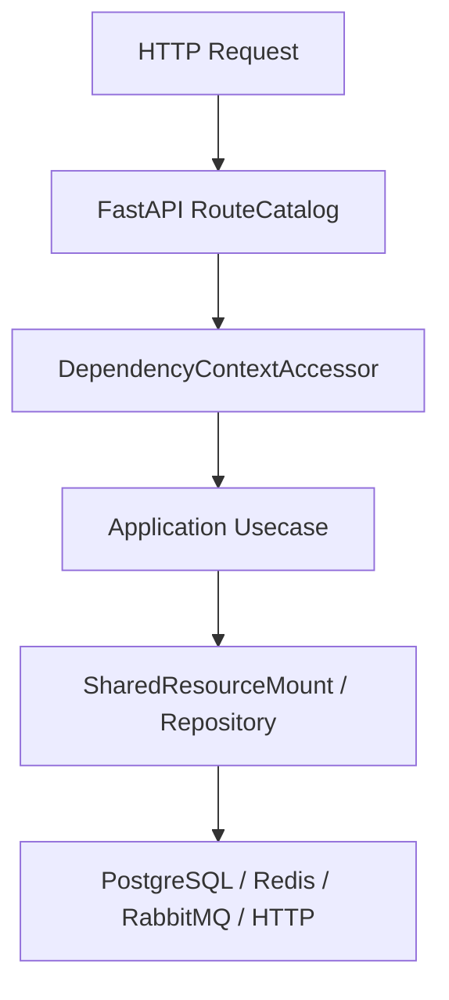

# 集成测试

## 1. 文档目的
说明 integration_test 外部依赖和跳过策略。

**最后更新范围**：覆盖 `test` 目录、`pyproject.toml` pytest 配置和 `src/infrastructure/testing` 测试支持。

## 2. 适用读者
- 测试维护者
- 后端开发者
- 新人开发者

## 3. 关联源码
| 路径 | 作用 |
| --- | --- |
| `pyproject.toml` | `pythonpath = ['.']`，`testpaths = ['test']`。 |
| `test/unit_test` | 单元测试。 |
| `test/contract_test` | 契约测试。 |
| `test/interface_test` | HTTP 接口测试。 |
| `test/integration_test` | 集成测试。 |
| `src/infrastructure/testing` | fake/test support，仅测试用途。 |

## 4. 核心结论
- 测试分层覆盖 unit、contract、interface、integration、boundary、exception、initialization、path、convention_usage、class_inheritance。
- `test/conftest.py` 会设置 `APP_ENV=test`、测试数据库 URL、测试 JWT_SECRET 和 bootstrap password。
- PostgreSQL、Redis、RabbitMQ 或 Docker 前置条件不可达时测试失败，阶段证据记为 `blocked`；不得以 skip/xfail 形成绿色回归。
- fake/test support 只用于测试，不应进入生产装配。

## 5. 结构说明
测试目录按风险面拆分：纯逻辑用 unit，模型约束用 contract，HTTP 行为用 interface，外部组件用 integration，启动和异常路径分别有独立层。

## 6. 工作流程

## 7. 关键实现
| 组件 | 文件 | 职责 |
| --- | --- | --- |
| `DatabaseResetPolicy` | `test/conftest.py` | 测试数据库重置策略。 |
| `RedisIntegrationAvailability.fail_when_unavailable` | `test/redis_integration_support.py` | Redis 不可达时让真实依赖回归失败。 |
| `TestAppFactory` | `src/api/testing/test_app_factory.py` | 测试应用工厂。 |

## 8. 如何修改或扩展
1. 定位改动影响层级。
2. 先补最窄 unit/contract 测试。
3. 若改 HTTP 表面，补 interface 测试。
4. 若改 PostgreSQL/Redis/RabbitMQ/Funboost，补显式 marker 的 integration 测试；缺少前置条件时保留失败和 `blocked` 证据。
5. 更新对应文档中的测试覆盖表。

## 9. 测试覆盖
| 测试类型 | 文件 | 验证内容 |
| --- | --- | --- |
| unit | `test/unit_test/test_fastapi_app_assembler_unit.py` | 装配器。 |
| contract | `test/contract_test/test_task_registration_contract.py` | 任务注册契约。 |
| interface | `test/interface_test/test_admin_task_interface.py` | 任务接口。 |
| integration | `test/integration_test/test_funboost_rabbitmq_integration.py` | RabbitMQ/funboost。 |

## 10. 常见问题
- 如果测试误连开发库，检查 `TEST_DATABASE_URL` 和 `TEST_DATABASE_RESET`。

## 11. 维护备注
新增测试层级或测试支持工具时，同步测试目录地图和开发指南。

### 测试目录索引

| 目录 | 用途 | 代表文件 |
| --- | --- | --- |
| `test/unit_test` | 纯逻辑和装配单元。 | `test_fastapi_app_assembler_unit.py` |
| `test/contract_test` | Pydantic/core contract。 | `test_http_contract.py` |
| `test/interface_test` | HTTP 接口表面。 | `test_admin_task_interface.py` |
| `test/integration_test` | 数据库、Redis、RabbitMQ 等外部组件。 | `test_funboost_rabbitmq_integration.py` |
| `test/boundary_test` | 边界条件。 | `test_hard_migration_module_boundary.py` |
| `test/exception_test` | 异常路径。 | `test_security_exception.py` |
| `test/initialization_test` | 启动初始化。 | `test_runtime_initialization.py` |
| `test/path_test` | 主路径/目录约定。 | `test_web_execution_path.py` |
| `test/convention_usage_test` | 用法约定。 | `test_end_to_end_usage.py` |
| `test/class_inheritance_test` | 运行时契约继承关系。 | `test_runtime_contract_inheritance.py` |

## 12. 相关文档
- [项目文档总览](../README.md)
- [测试规范](../../standard/测试规范.md)

## 13. 当前代码树校准（2026-06-22）

`test/integration_test` 当前有 19 个 `test_*.py` 文件，含 `admin_identity` 子目录。集成层覆盖应用启动、PostgreSQL 链路、Redis、RabbitMQ/funboost、迁移任务、生产安全配置、后台管理 smoke 和 RBAC 端到端链路。

| 依赖/链路 | 代表文件 | 运行条件 |
| --- | --- | --- |
| 应用与后台管理 smoke | `test_app_integration.py`、`test_admin_smoke_integration.py`、`test_admin_business_console_smoke_integration.py` | 声明 `postgres` 并显式使用 `integration_database`。 |
| 数据库日志、任务记录、迁移任务 | `test_database_logging_integration.py`、`test_task_execution_record_integration.py`、`test_migration_job_integration.py` | 依赖 PostgreSQL 测试库。 |
| Redis 缓存、分布式锁、密钥、安全 IP 阻断 | `test_cache_integration.py`、`test_distributed_lock_redis_integration.py`、`test_key_management_redis_integration.py`、`test_security_ip_block_integration.py` | 通过 `RedisIntegrationAvailability.fail_when_unavailable(...)` 在 Redis 不可达时失败并形成 blocked 证据。 |
| RabbitMQ/Funboost | `test_funboost_rabbitmq_integration.py` | 需要真实 RabbitMQ；可用 `RABBITMQ_TEST_URL` 覆盖连接串，依赖不可达时测试失败并记录为 blocked。 |
| 生产配置和 RBAC | `test_security_production_integration.py`、`admin_identity/test_admin_identity_rbac_integration.py` | 校验生产配置约束和身份权限链路。 |

运行集成层可用 `.\.venv\Scripts\python.exe -m pytest -q test\integration_test`。PostgreSQL、Redis 或 RabbitMQ 缺失时均由 fixture 或真实可达性检查明确失败；阶段证据必须记为 `blocked`，不得合并到 passed，也不得转成 skip/xfail。
