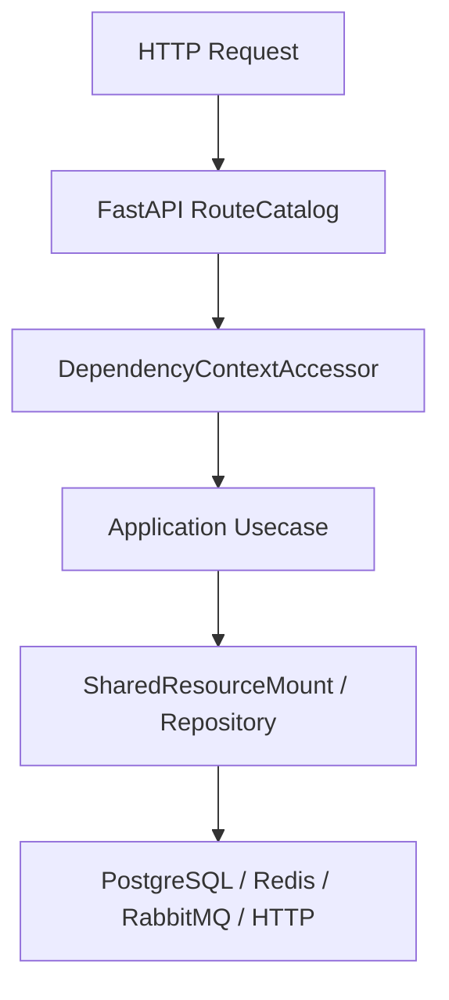

# 测试目录地图

## 1. 文档目的
说明 `test` 目录每层职责。

**最后更新范围**：覆盖 `test` 目录、`pyproject.toml` pytest 配置和 `src/infrastructure/testing` 测试支持。

## 2. 适用读者
- 测试维护者
- 后端开发者
- 新人开发者

## 3. 关联源码
| 路径 | 作用 |
| --- | --- |
| `pyproject.toml` | `pythonpath = ['.']`，`testpaths = ['test']`。 |
| `test/unit_test` | 单元测试。 |
| `test/contract_test` | 契约测试。 |
| `test/interface_test` | HTTP 接口测试。 |
| `test/integration_test` | 集成测试。 |
| `src/infrastructure/testing` | fake/test support，仅测试用途。 |

## 4. 核心结论
- 测试分层覆盖 unit、contract、interface、integration、boundary、exception、initialization、path、convention_usage、class_inheritance。
- `test/conftest.py` 会设置 `APP_ENV=test`、测试数据库 URL、测试 JWT_SECRET 和 bootstrap password。
- Redis 与 RabbitMQ/Funboost 集成测试直接检查真实依赖；不可达时失败并形成 blocked 证据，不允许 skip/xfail 进入绿色 regression。
- fake/test support 只用于测试，不应进入生产装配。

## 5. 结构说明
测试目录按风险面拆分：纯逻辑用 unit，模型约束用 contract，HTTP 行为用 interface，外部组件用 integration，启动和异常路径分别有独立层。

## 6. 工作流程

## 7. 关键实现
| 组件 | 文件 | 职责 |
| --- | --- | --- |
| `DatabaseResetPolicy` | `test/conftest.py` | 测试数据库重置策略。 |
| `RedisIntegrationAvailability.fail_when_unavailable` | `test/redis_integration_support.py` | Redis 不可达时让真实依赖回归失败。 |
| `TestAppFactory` | `src/api/testing/test_app_factory.py` | 测试应用工厂。 |

## 8. 如何修改或扩展
1. 定位改动影响层级。
2. 先补最窄 unit/contract 测试。
3. 若改 HTTP 表面，补 interface 测试。
4. 若改 PostgreSQL/Redis/RabbitMQ/funboost，补 integration 和依赖缺失失败证据。
5. 更新对应文档中的测试覆盖表。

## 9. 测试覆盖
| 测试类型 | 文件 | 验证内容 |
| --- | --- | --- |
| unit | `test/unit_test/test_fastapi_app_assembler_unit.py` | 装配器。 |
| contract | `test/contract_test/test_task_registration_contract.py` | 任务注册契约。 |
| interface | `test/interface_test/test_admin_task_interface.py` | 任务接口。 |
| integration | `test/integration_test/test_funboost_rabbitmq_integration.py` | RabbitMQ/funboost。 |

## 10. 常见问题
- 如果测试误连开发库，检查 `TEST_DATABASE_URL` 和 `TEST_DATABASE_RESET`。

## 11. 维护备注
新增测试层级或测试支持工具时，同步测试目录地图和开发指南。

### 测试目录索引

| 目录 | 用途 | 代表文件 |
| --- | --- | --- |
| `test/unit_test` | 纯逻辑和装配单元。 | `test_fastapi_app_assembler_unit.py` |
| `test/contract_test` | Pydantic/core contract。 | `test_http_contract.py` |
| `test/interface_test` | HTTP 接口表面。 | `test_admin_task_interface.py` |
| `test/integration_test` | 数据库、Redis、RabbitMQ 等外部组件。 | `test_funboost_rabbitmq_integration.py` |
| `test/boundary_test` | 边界条件。 | `test_hard_migration_module_boundary.py` |
| `test/exception_test` | 异常路径。 | `test_security_exception.py` |
| `test/initialization_test` | 启动初始化。 | `test_runtime_initialization.py` |
| `test/path_test` | 主路径/目录约定。 | `test_web_execution_path.py` |
| `test/convention_usage_test` | 用法约定。 | `test_end_to_end_usage.py` |
| `test/class_inheritance_test` | 运行时契约继承关系。 | `test_runtime_contract_inheritance.py` |

## 12. 相关文档
- [项目文档总览](../README.md)
- [测试规范](../../standard/测试规范.md)

## 13. 代码树校准（2026-06-22）

本次按当前 `test/**`、`test/conftest.py` 与 `pyproject.toml` 复核后，目录地图以源码树为准：

| 目录 | 当前职责 | 代表文件 |
| --- | --- | --- |
| `test/unit_test` | 单元、用例、端口、装配和测试支撑策略；含 `admin_audit`、`admin_identity/{role,scope,user}` 子目录。 | `test_test_database_isolation_unit.py`、`admin_identity/user/test_admin_user_usecase_unit.py` |
| `test/contract_test` | Pydantic/core/API envelope/任务/安全/日志/指标/身份与审计契约；含 `admin_audit`、`admin_identity` 子目录。 | `test_task_registration_contract.py`、`admin_identity/test_admin_identity_contract.py` |
| `test/interface_test` | FastAPI/TestClient HTTP 表面、管理端接口、指标、限流、安全事件；含 `admin_audit`、`admin_identity` 子目录。 | `test_admin_task_interface.py`、`admin_identity/test_admin_user_interface.py` |
| `test/integration_test` | 应用启动、数据库链路、Redis、RabbitMQ/funboost、迁移任务、安全生产配置和 RBAC 集成；含 `admin_identity` 子目录。 | `test_app_integration.py`、`test_funboost_rabbitmq_integration.py` |
| `test/boundary_test` | runtime/security/task 等边界值和上限下限规则。 | `test_hard_migration_module_boundary.py` |
| `test/exception_test` | 异常转换、失败路径、敏感信息脱敏和 fail-open/fail-closed 行为。 | `test_runtime_exception.py`、`test_logging_redaction_exception.py` |
| `test/initialization_test` | bootstrap、logging、cache、runtime、security、task runtime、observability 初始化。 | `test_bootstrap_initialization.py` |
| `test/path_test` | 主流程、配置重载、任务运行时、缓存、日志、Web execution path。 | `test_runtime_path.py`、`test_task_runtime_path.py` |
| `test/convention_usage_test` | 端到端用法链路和约定用法。 | `test_end_to_end_usage.py` |
| `test/class_inheritance_test` | 运行时契约继承关系。 | `test_runtime_contract_inheritance.py` |

运行入口仍由 `pyproject.toml` 控制：`pythonpath = ["."]`、`testpaths = ["test"]`。优先使用项目解释器运行 `.\.venv\Scripts\python.exe -m pytest -q`；定点复核可追加具体路径，例如 `.\.venv\Scripts\python.exe -m pytest -q test\interface_test\admin_identity`。

`test/conftest.py` 是离线环境与外部资源防护入口：默认设置测试环境和安全密钥，非外部 marker 使用 SQLite，并阻止未声明的真实网络连接。PostgreSQL 创建、锁和 `_test` 后缀重置只在 `test/integration_test/conftest.py` 的显式 `integration_database` fixture 中发生。

Redis 相关集成/初始化测试通过 `test/redis_integration_support.py` 的 `RedisIntegrationAvailability.fail_when_unavailable(...)` 让不可达依赖显式失败；RabbitMQ/Funboost 集成测试直接检查真实 broker，连接串可用 `RABBITMQ_TEST_URL` 覆盖。
