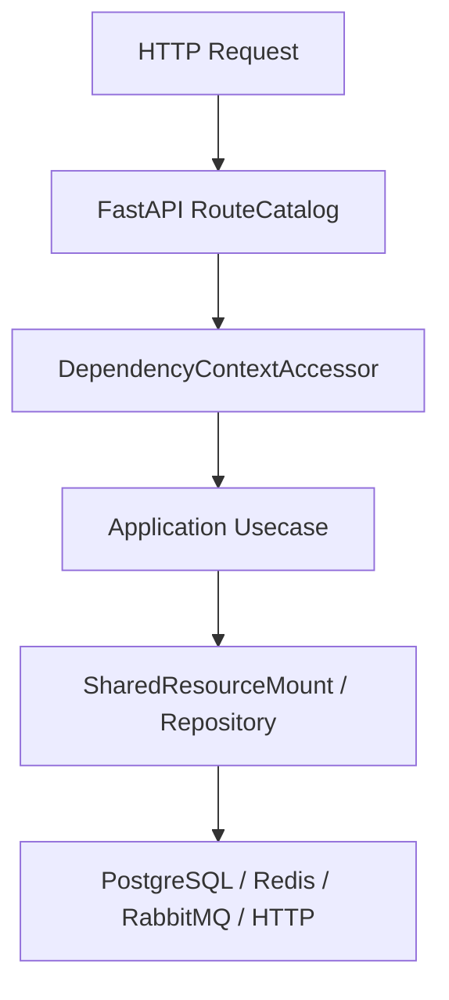

# 测试策略

## 1. 文档目的
说明分层测试目标和依赖资源。

**最后更新范围**：覆盖 `test` 目录、`pyproject.toml` pytest 配置和 `src/infrastructure/testing` 测试支持。

## 2. 适用读者
- 测试维护者
- 后端开发者
- 新人开发者

## 3. 关联源码
| 路径 | 作用 |
| --- | --- |
| `pyproject.toml` | `pythonpath = ['.']`，`testpaths = ['test']`。 |
| `test/unit_test` | 单元测试。 |
| `test/contract_test` | 契约测试。 |
| `test/interface_test` | HTTP 接口测试。 |
| `test/integration_test` | 集成测试。 |
| `src/infrastructure/testing` | fake/test support，仅测试用途。 |
| `Dockerfile` | 当前镜像构建会复制整个 `src` 目录。 |

## 4. 核心结论
- 测试分层覆盖 unit、contract、interface、integration、boundary、exception、initialization、path、convention_usage、class_inheritance。
- `test/conftest.py` 只设置测试安全默认值并安装外部连接防护；非外部 marker 测试默认使用每应用隔离、可释放的临时文件 SQLite，不准备 PostgreSQL。
- PostgreSQL、Redis、RabbitMQ、Docker 通过显式 marker 声明。PostgreSQL 还必须显式使用 `integration_database`；真实依赖不可达时测试失败，阶段证据记为 `blocked`，不得以 skip/xfail 形成绿色 regression。
- fake/test support 只用于测试，不应进入生产装配。
- 当前项目固定全量入口为 `.\.venv\Scripts\python.exe -m pytest -q`；离线统一入口为 `uv run nox -s offline`，质量入口为 `uv run nox -s static`。
- Nox regression 执行 pytest-cov 总体 line/branch 85% 门禁及四域 90% 门禁；当前总体组合覆盖率为 85.35257049984318%，auth/security/task/persistence 分别为 93.3333%、91.1565%、92.3467%、91.0800%。
- `Dockerfile` 当前 `COPY src ./src` 会把 `src/infrastructure/testing` 一起放入镜像文件系统；已确认生产装配路径不直接引用 `TestAppFactory` 等测试工厂，但待确认镜像安全策略是否要求从运行镜像排除测试 support。

## 5. 结构说明
测试目录按风险面拆分：纯逻辑用 unit，模型约束用 contract，HTTP 行为用 interface，外部组件用 integration，启动和异常路径分别有独立层。

## 6. 工作流程

## 7. 关键实现
| 组件 | 文件 | 职责 |
| --- | --- | --- |
| `OfflineExternalResourceGuard` | `test/conftest.py` | 阻止未声明 marker 的测试访问真实网络和 PostgreSQL。 |
| `IntegrationDatabaseHarness` | `test/integration_test/conftest.py` | 只为显式 PostgreSQL 集成测试创建、重置并迁移 `_test` 数据库。 |
| `RedisIntegrationAvailability.fail_when_unavailable` | `test/redis_integration_support.py` | Redis 不可达时让真实依赖回归失败。 |
| `TestAppFactory` | `src/api/testing/test_app_factory.py` | 测试应用工厂，离线默认注入 SQLite 引擎工厂。 |
| `Dockerfile` | `Dockerfile` | 构建时复制 `src` 目录，测试 support 文件会随源码进入镜像。 |

## 8. 如何修改或扩展
1. 定位改动影响层级。
2. 先补最窄 unit/contract 测试。
3. 若改 HTTP 表面，补 interface 测试。
4. 若改 PostgreSQL/Redis/RabbitMQ/funboost，补 integration，并让依赖缺失显式失败或记录为 blocked。
5. 更新对应文档中的测试覆盖表。

## 9. 测试覆盖
| 测试类型 | 文件 | 验证内容 |
| --- | --- | --- |
| unit | `test/unit_test/test_fastapi_app_assembler_unit.py` | 装配器。 |
| contract | `test/contract_test/test_task_registration_contract.py` | 任务注册契约。 |
| interface | `test/interface_test/test_admin_task_interface.py` | 任务接口。 |
| integration | `test/integration_test/test_funboost_rabbitmq_integration.py` | RabbitMQ/funboost。 |

## 10. 常见问题
- 如果测试误连开发库，检查 `TEST_DATABASE_URL` 和 `TEST_DATABASE_RESET`。
- 如果镜像审计发现 `src/infrastructure/testing`，先确认是否为构建策略问题；这些 helper 的用途是测试装配，不应被生产路由或应用装配依赖。

## 11. 维护备注
新增测试层级或测试支持工具时，同步测试目录地图和开发指南。

### 测试目录索引

| 目录 | 用途 | 代表文件 |
| --- | --- | --- |
| `test/unit_test` | 纯逻辑和装配单元。 | `test_fastapi_app_assembler_unit.py` |
| `test/contract_test` | Pydantic/core contract。 | `test_http_contract.py` |
| `test/interface_test` | HTTP 接口表面。 | `test_admin_task_interface.py` |
| `test/integration_test` | 数据库、Redis、RabbitMQ 等外部组件。 | `test_funboost_rabbitmq_integration.py` |
| `test/boundary_test` | 边界条件。 | `test_hard_migration_module_boundary.py` |
| `test/exception_test` | 异常路径。 | `test_security_exception.py` |
| `test/initialization_test` | 启动初始化。 | `test_runtime_initialization.py` |
| `test/path_test` | 主路径/目录约定。 | `test_web_execution_path.py` |
| `test/convention_usage_test` | 用法约定。 | `test_end_to_end_usage.py` |
| `test/class_inheritance_test` | 运行时契约继承关系。 | `test_runtime_contract_inheritance.py` |

## 12. 相关文档
- [项目文档总览](../README.md)
- [测试规范](../../standard/测试规范.md)

## 13. 当前代码树校准（2026-06-22）

当前源码级测试目录以 `pyproject.toml` 的 `testpaths = ["test"]` 为入口，`pythonpath = ["."]` 确保从项目根导入 `src` 和 `test` 支撑模块。根 `conftest` 的 autouse fixture 只选择 SQLite/配置后端并阻止未声明外部连接；`.tmp/test_database_session.lock` 和 `_test` 后缀重置策略仅位于 `test/integration_test/conftest.py`，由显式 `integration_database` fixture 启用。

| 层级 | 当前文件数 | 说明 |
| --- | ---: | --- |
| `test/unit_test` | 47 | 纯逻辑、用例、端口、装配、fake/test support 策略和测试数据库隔离。 |
| `test/contract_test` | 19 | API envelope、端口协议、任务、安全、日志、指标、身份与审计契约。 |
| `test/interface_test` | 16 | FastAPI/TestClient HTTP 表面、管理端接口、限流、指标、安全事件。 |
| `test/integration_test` | 19 | 应用启动、数据库、Redis、RabbitMQ/funboost、迁移、生产配置、RBAC。 |
| `test/performance` | 2 个 pytest 文件及场景/调参脚本 | Locust 强类型运行配置、稳定/突发/过载/退化/多实例场景与 autotuner。 |
| `test/boundary_test` | 4 | runtime/security/task 等边界值和上下限。 |
| `test/exception_test` | 6 | 异常转换、故障注入、脱敏、fail-open/fail-closed。 |
| `test/initialization_test` | 9 | bootstrap、cache、logging、observability、runtime、security、task runtime 初始化。 |
| `test/path_test` | 8 | 主链路、配置重载、任务/缓存/日志/key/Web execution path。 |
| `test/convention_usage_test` | 1 | 端到端用法约定链路。 |
| `test/class_inheritance_test` | 1 | runtime contract inheritance。 |

Redis 与 RabbitMQ/Funboost 集成测试始终执行真实可达性检查，不再由启用开关静默跳过；可用 `RABBITMQ_TEST_URL` 覆盖连接串。当前基线离线入口为 926 passed、5 warnings；真实依赖全量回归为 1077 passed、241 warnings，无 skip/xfail。仓库当前没有 `ad_hoc_test`、`human_generated` 或 `llm_generated` 目录；若未来新增，`ad_hoc_test` 仅用于未晋升探索，`human_generated`/`llm_generated` 仅标记来源，均不得替代风险分层。
