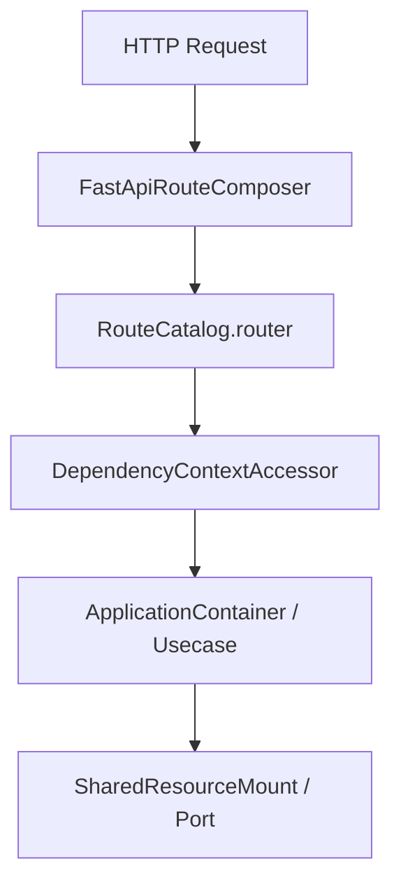

# 新增 API

## 1. 文档目的
给出新增 API 的实际步骤。

**最后更新范围**：覆盖当前目录约定、核心开发流程和必须同步更新的文档。

## 2. 适用读者
- 新人开发者
- 后端开发者
- 测试维护者

## 3. 关联源码
| 路径 | 作用 |
| --- | --- |
| `src/api/endpoint_*` | API 模块。 |
| `src/application` | 用例层。 |
| `src/application/ports` | 端口。 |
| `src/infrastructure` | 运行时组件。 |
| `config` | 配置。 |
| `test` | 测试。 |
| `docs/standard` | 已有编码/命名/测试规范。 |

## 4. 核心结论
- 新增 API 必须同时维护 `endpoint_*` 目录内的 `route_*`、`contract_*`、`*BundleProvider`，以及 `web_module_manifest.py` 中的 manifest 条目。
- 路由层只负责 HTTP 入参、鉴权依赖、响应契约和调用用例；业务动作进入 `src/application`，外部资源通过 `DependencyContextAccessor` 读取容器依赖。
- 新增后台模块时必须明确 `admin_boundary_policy`，并同步 `app.modules.enabled` 可选模块配置。
- API 变更必须配套契约测试和接口测试；模块注册、启用列表、前缀挂载要有单元或路径测试覆盖。

## 5. 结构说明
开发流程以真实代码边界为准，历史执行方案只作参考。

## 6. 工作流程

## 7. 关键实现
| 组件 | 文件 | 职责 |
| --- | --- | --- |
| `WebModuleManifestRegistry` | `src/api/web_module_manifest.py` | API 模块注册。 |
| `WebBundleCatalog` | `src/api/web_bundle_catalog.py` | 按 manifest 导入 `WebBundleProvider` 并校验模块名。 |
| `<Module>RouteCatalog` | `src/api/endpoint_*/route_*.py` | 创建 `APIRouter`，注册路径、方法和 `response_model`。 |
| `<Module>BundleProvider` | `src/api/endpoint_*/route_*.py` | 返回 `WebBundleProviderEnvelope` 和 `WebBundle`。 |
| `DependencyContextAccessor` | `src/api/dependency_context_accessor.py` | 从 `request.app.state.container` 读取用例、响应工厂和桥接器。 |
| `FastApiAppAssembler._build_application_container` | `src/api/fastapi_app_assembler.py` | 用例注入。 |
| `FastApiRouteComposer` | `src/infrastructure/fastapi_route_composer.py` | 按 `app.modules.enabled` 和 `runtime.web.api_prefix` 挂载路由。 |

## 8. 如何修改或扩展
1. 在 `src/api/endpoint_<module>` 下新增或调整 `contract_<module>.py`，响应模型使用 Pydantic，并保持 `kind`、`schema_version` 和 `extra="forbid"` 风格。
2. 在 `route_<module>.py` 中新增 `<Module>RouteCatalog`，通过 `self.router.add_api_route(...)` 显式声明路径、方法和 `ResponseEnvelope[...]`。
3. 如路由调用新的应用能力，先完成用例和端口，再在 `ApplicationContainer` 与 `DependencyContextAccessor.read_*_usecase` 中接线。
4. 新模块要补 `ApplicationModuleName`、`WebModuleManifestRegistry` provider 导入路径、route tag 和后台边界策略；已有模块新增接口通常不需要新增 manifest。
5. 检查 `config/app_*.toml` 的 `app.modules.enabled` 是否需要加入模块，并验证 `runtime.web.api_prefix` 下接口路径仍正确。
6. 运行相关测试后，同步更新 `/docs/project_manual` 中面向调用方的 API 文档。
7. 公开契约变更评审通过后，显式运行 `uv run python -m src.cli.generate_phase_evidence --accept-public-contract-baseline` 更新冻结基线；普通文档回归只运行不带该参数的命令，未声明差异必须继续阻断。

## 9. 测试覆盖
| 测试类型 | 文件 | 验证内容 |
| --- | --- | --- |
| unit | `test/unit_test/test_web_module_manifest_unit.py` | manifest、provider、启用模块校验。 |
| contract | `test/contract_test/test_http_contract.py` 或模块专属 `test/contract_test/**` | 响应信封、字段、枚举和 schema 版本。 |
| interface | `test/interface_test/test_http_interface.py` 或模块专属 `test/interface_test/**` | HTTP 状态码、鉴权、错误响应和真实路径。 |
| path | `test/path_test/test_web_execution_path.py` | 请求执行桥、API 前缀和路由挂载路径。 |

## 10. 常见问题
- 如果一个改动需要跨多个层级，优先拆成 contract/usecase/adapter/API/test 小步。

## 11. 维护备注
开发指南变更时同步 README 高频任务入口。

## 12. 相关文档
- [项目文档总览](../README.md)
- [编码规范](../../standard/编码规范.md)
- [命名规范](../../standard/命名规范.md)
- [测试规范](../../standard/测试规范.md)
