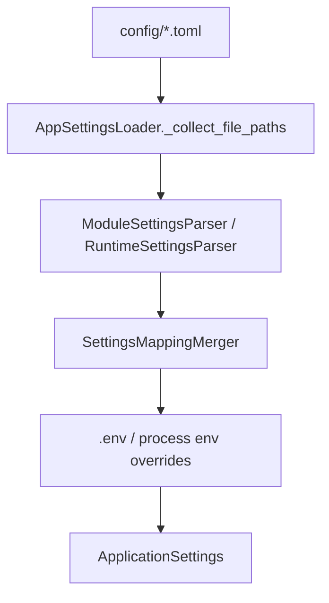

# 新增配置

## 1. 文档目的
给出新增配置项的步骤。

**最后更新范围**：覆盖当前目录约定、核心开发流程和必须同步更新的文档。

## 2. 适用读者
- 新人开发者
- 后端开发者
- 测试维护者

## 3. 关联源码
| 路径 | 作用 |
| --- | --- |
| `src/api/endpoint_*` | API 模块。 |
| `src/application` | 用例层。 |
| `src/application/ports` | 端口。 |
| `src/infrastructure` | 运行时组件。 |
| `config` | 配置。 |
| `test` | 测试。 |
| `docs/standard` | 已有编码/命名/测试规范。 |

## 4. 核心结论
- 新增配置必须先确定归属：`app`、`modules.<module>` 或 `runtime.<runtime_key>`，不要把运行时连接、业务开关和模块参数混在同一层。
- 配置文件按 `base -> environment` 合并；`.env` 只在非 production 生效，进程环境变量最后覆盖敏感值和连接串。
- 新字段必须同步 `AppSettingsLoader` 的 Raw 映射、Pydantic Settings 模型、解析/校验逻辑、热更新策略和测试。
- 生产配置涉及密钥、数据库、Redis、RabbitMQ 时，以 `SettingsSecurityValidator` 和环境变量约束为准。

## 5. 结构说明
开发流程以真实代码边界为准，历史执行方案只作参考。

## 6. 工作流程

## 7. 关键实现
| 组件 | 文件 | 职责 |
| --- | --- | --- |
| `AppSettingsLoader` | `src/infrastructure/settings/app_settings_loader.py` | 配置模型。 |
| `ModuleSettingsParser` | `src/infrastructure/settings/parsers/module_settings_parser.py` | 将 `config/modules/*_module/*.toml` 路由到模块配置。 |
| `RuntimeSettingsParser` | `src/infrastructure/settings/parsers/runtime_settings_parser.py` | 将 `config/runtime/*_runtime/*.toml` 路由到运行时配置。 |
| `SettingsMappingMerger` | `src/infrastructure/settings/settings_mapping_merger.py` | 递归合并 base、环境层和 overrides。 |
| `SettingsReloadCoordinator` | `src/infrastructure/settings/settings_reload_coordinator.py` | 校验热更新与重启要求。 |
| `SettingsSecurityValidator` | `src/infrastructure/settings/settings_security_validator.py` | 校验 production 敏感配置来源和强度。 |

## 8. 如何修改或扩展
1. 先选择配置归属和文件位置：`config/app_*.toml`、`config/modules/<name>_module/<name>_module_*.toml` 或 `config/runtime/<name>_runtime/<name>_runtime_*.toml`。
2. 在 `app_settings_loader.py` 中补 Raw `TypedDict`、Settings `BaseModel`、默认值/校验器；稳定结构不要用裸 `dict`。
3. 如新增 runtime 或 module 目录，补 `_collect_file_paths`、对应 parser 允许列表和最终 `ApplicationSettings` 字段。
4. 如允许环境变量覆盖，补 `_apply_source_overrides`；production 敏感项必须进入 `SettingsSecurityValidator`。
5. 如配置支持热更新，补 `config/app_base.toml` 中 `app.reload.hot_reload_allowed`；不能热更新的路径放入 `restart_required`。
6. 同步 development/test/production 差异，缺少某环境文件时必须确认 base 默认值可用。

## 9. 测试覆盖
| 测试类型 | 文件 | 验证内容 |
| --- | --- | --- |
| unit | `test/unit_test/test_dotenv_settings_loader_unit.py` | `.env` 与进程环境变量覆盖。 |
| unit | `test/unit_test/test_settings_security_unit.py` | production 密钥和外部依赖安全约束。 |
| path | `test/path_test/test_runtime_path.py` | runtime 配置解析、归一化和非法值。 |
| initialization | `test/initialization_test/test_runtime_initialization.py` | 应用装配时配置可加载。 |
| interface | `test/interface_test/test_admin_settings_interface.py` | 配置重载接口和结果语义。 |

## 10. 常见问题
- 如果一个改动需要跨多个层级，优先拆成 contract/usecase/adapter/API/test 小步。

## 11. 维护备注
开发指南变更时同步 README 高频任务入口。

## 12. 相关文档
- [项目文档总览](../README.md)
- [编码规范](../../standard/编码规范.md)
- [命名规范](../../standard/命名规范.md)
- [测试规范](../../standard/测试规范.md)
