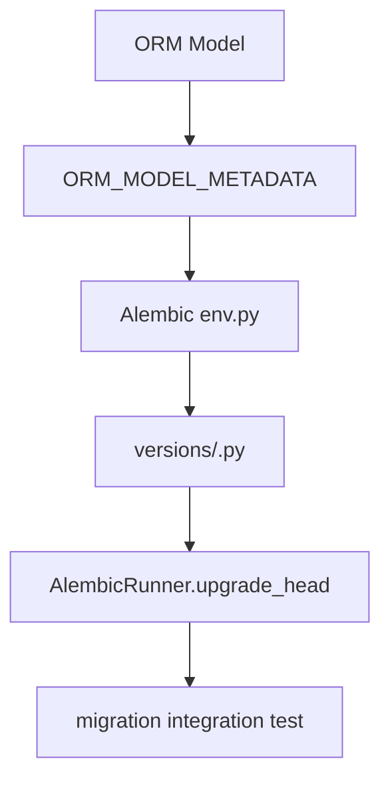

# 新增迁移

## 1. 文档目的
给出新增数据库迁移的步骤。

**最后更新范围**：覆盖当前目录约定、核心开发流程和必须同步更新的文档。

## 2. 适用读者
- 新人开发者
- 后端开发者
- 测试维护者

## 3. 关联源码
| 路径 | 作用 |
| --- | --- |
| `src/api/endpoint_*` | API 模块。 |
| `src/application` | 用例层。 |
| `src/application/ports` | 端口。 |
| `src/infrastructure` | 运行时组件。 |
| `config` | 配置。 |
| `test` | 测试。 |
| `docs/standard` | 已有编码/命名/测试规范。 |

## 4. 核心结论
- 新增迁移必须同步 SQLAlchemy ORM、Alembic 版本文件、repository 实现和迁移集成测试。
- Alembic 环境使用 `ORM_MODEL_METADATA`，并在 `env.py` 中开启 `compare_type` 与 `compare_server_default`；模型漂移以代码和迁移共同收口。
- 版本文件当前采用 `YYYYMMDDHHMM_描述.py`、`REVISION_ID`、`DOWN_REVISION_ID`、`Migration` 类和 `upgrade = Migration().upgrade` 风格。
- 修改历史数据或约束时，必须写可重复、可解释的数据修复步骤，不能只依赖自动生成结构差异。

## 5. 结构说明
开发流程以真实代码边界为准，历史执行方案只作参考。

## 6. 工作流程

## 7. 关键实现
| 组件 | 文件 | 职责 |
| --- | --- | --- |
| `OrmModelBase` / `ORM_MODEL_METADATA` | `src/infrastructure/persistence/sqlalchemy_metadata_registry.py` | ORM 元数据事实源。 |
| ORM 模型 | `src/infrastructure/persistence/orm_model/*.py` | 表名、字段、索引和约束。 |
| Alembic 环境 | `src/infrastructure/persistence/alembic/env.py` | 读取数据库 URL、schema、连接超时并运行迁移。 |
| 版本文件 | `src/infrastructure/persistence/alembic/versions/*.py` | `upgrade` / `downgrade` 和数据修复步骤。 |
| `AlembicRunner` | `src/infrastructure/persistence/alembic_runner.py` | 从数据库 runtime 配置执行 `upgrade head`。 |

## 8. 如何修改或扩展
1. 先更新或新增 `orm_model`，字段长度、nullable、索引名、外键名应使用常量表达，避免迁移和模型各写一套魔法字符串。
2. 在 `alembic/versions` 新增单线性 revision，确认 `down_revision` 指向当前 head；文件名和 `REVISION_ID` 保持一致。
3. `upgrade` 先处理历史脏数据或默认值，再创建约束/索引/类型变更；涉及不可逆数据变更时在注释或函数名中明确语义。
4. `downgrade` 至少撤销结构变更；无法恢复的数据语义要显式说明，不要留下静默半降级。
5. 如 repository、查询端口或 API 依赖新字段，同步更新 `repository_impl`、契约模型和对应测试。
6. 使用 test 数据库执行迁移集成测试；不要在生产样式配置中硬编码本地连接串。

## 9. 测试覆盖
| 测试类型 | 文件 | 验证内容 |
| --- | --- | --- |
| integration | `test/integration_test/test_migration_job_integration.py` | `upgrade head`、历史 revision 升级和失败返回。 |
| unit | `test/unit_test/test_task_execution_record_repository_unit.py` 或相关 repository 单测 | 新字段读写和查询条件。 |
| contract | `test/contract_test/test_task_execution_contract.py` 或相关契约测试 | 持久化字段进入契约后的结构兼容性。 |
| boundary | `test/boundary_test/**` | 长度、唯一约束、分页或时间边界。 |

## 10. 常见问题
- 如果一个改动需要跨多个层级，优先拆成 contract/usecase/adapter/API/test 小步。

## 11. 维护备注
开发指南变更时同步 README 高频任务入口。

## 12. 相关文档
- [项目文档总览](../README.md)
- [编码规范](../../standard/编码规范.md)
- [命名规范](../../standard/命名规范.md)
- [测试规范](../../standard/测试规范.md)
