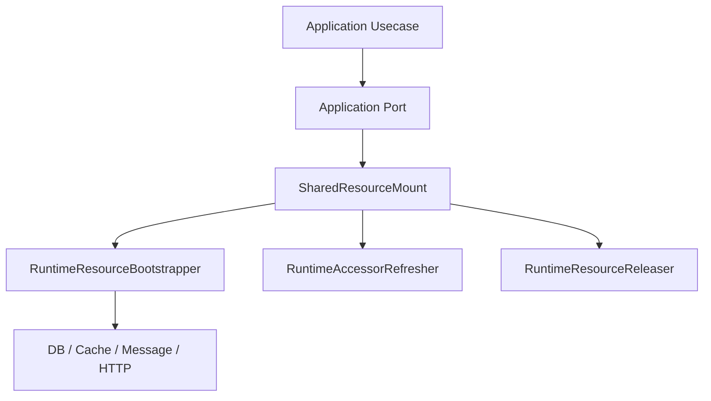

# 新增运行时组件

## 1. 文档目的
给出新增基础设施运行时组件的步骤。

**最后更新范围**：覆盖当前目录约定、核心开发流程和必须同步更新的文档。

## 2. 适用读者
- 新人开发者
- 后端开发者
- 测试维护者

## 3. 关联源码
| 路径 | 作用 |
| --- | --- |
| `src/api/endpoint_*` | API 模块。 |
| `src/application` | 用例层。 |
| `src/application/ports` | 端口。 |
| `src/infrastructure` | 运行时组件。 |
| `config` | 配置。 |
| `test` | 测试。 |
| `docs/standard` | 已有编码/命名/测试规范。 |

## 4. 核心结论
- 新增运行时组件优先挂到 `SharedResourceMount` 或其下的 resource mount / resource slot，不要让 API 或用例直接 new 基础设施实现。
- 应用层通过 `Protocol` 端口依赖能力，基础设施组件实现端口并由 `FastApiAppAssembler` 装配。
- 运行时组件如果受配置驱动，必须同步 runtime 配置模型、`SharedResourceMount.apply_settings`/重载策略和初始化测试。
- 涉及外部依赖的组件必须具备可替换测试实现或受控集成测试，避免单元测试连真实网络、数据库或消息队列。

## 5. 结构说明
开发流程以真实代码边界为准，历史执行方案只作参考。

## 6. 工作流程

## 7. 关键实现
| 组件 | 文件 | 职责 |
| --- | --- | --- |
| `FastApiAppAssembler._build_application_container` | `src/api/fastapi_app_assembler.py` | 用例注入。 |
| `SharedResourceMount` | `src/infrastructure/shared_resource_mount.py` | 集中持有数据库、缓存、任务、鉴权、日志等运行时资源。 |
| `RuntimeResourceBootstrapper` | `src/infrastructure/resource_mount/runtime_resource_bootstrapper.py` | 启动阶段挂载运行时资源。 |
| `RuntimeAccessorRefresher` | `src/infrastructure/resource_mount/runtime_accessor_refresher.py` | 配置应用后刷新访问器。 |
| `RuntimeResourceReleaser` | `src/infrastructure/resource_mount/runtime_resource_releaser.py` | 生命周期结束时释放资源。 |
| `SettingsApplyTransaction` | `src/infrastructure/settings/settings_apply_transaction.py` | 配置热更新的应用事务。 |
| `AppSettingsLoader` | `src/infrastructure/settings/app_settings_loader.py` | 配置模型。 |

## 8. 如何修改或扩展
1. 先定义应用层端口或复用现有端口，例如 `SettingsReaderPort`、`TaskRuntimePort`、`AuthRuntimePort`；用例构造函数只接收端口。
2. 在 `src/infrastructure` 下新增实现，外部依赖放在构造参数或受 `ApplicationSettings` 驱动，避免读取全局环境。
3. 在 `SharedResourceMount` 中集中创建、读取、健康状态和释放逻辑；如需要启动/重载/释放，补 resource mount 相关类。
4. 在 `FastApiAppAssembler` 中装配资源和用例，不要在 route 中创建运行时组件。
5. 如组件有配置，按“新增配置”指南补 `config/runtime/*`、Settings 模型、热更新策略和 production 安全校验。
6. 如组件引入数据库结构或持久化记录，按“新增迁移”指南同步 ORM、repository 和 Alembic。

## 9. 测试覆盖
| 测试类型 | 文件 | 验证内容 |
| --- | --- | --- |
| unit | `test/unit_test/test_resource_mount_lifecycle_unit.py` | 资源挂载、释放和状态变化。 |
| unit | `test/unit_test/test_settings_apply_transaction_unit.py` | 配置热更新事务和回滚。 |
| initialization | `test/initialization_test/test_runtime_initialization.py` | 应用启动装配。 |
| integration | `test/integration_test/**` | 数据库、Redis、RabbitMQ、HTTP 等真实依赖联动。 |
| path | `test/path_test/test_runtime_path.py` | 运行时配置分支和错误路径。 |

## 10. 常见问题
- 如果一个改动需要跨多个层级，优先拆成 contract/usecase/adapter/API/test 小步。

## 11. 维护备注
开发指南变更时同步 README 高频任务入口。

## 12. 相关文档
- [项目文档总览](../README.md)
- [编码规范](../../standard/编码规范.md)
- [命名规范](../../standard/命名规范.md)
- [测试规范](../../standard/测试规范.md)
