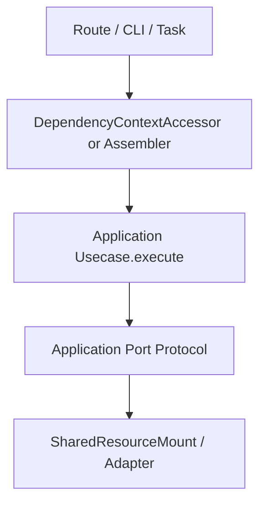

# 新增用例

## 1. 文档目的
给出新增应用用例的实际步骤。

**最后更新范围**：覆盖当前目录约定、核心开发流程和必须同步更新的文档。

## 2. 适用读者
- 新人开发者
- 后端开发者
- 测试维护者

## 3. 关联源码
| 路径 | 作用 |
| --- | --- |
| `src/api/endpoint_*` | API 模块。 |
| `src/application` | 用例层。 |
| `src/application/ports` | 端口。 |
| `src/infrastructure` | 运行时组件。 |
| `config` | 配置。 |
| `test` | 测试。 |
| `docs/standard` | 已有编码/命名/测试规范。 |

## 4. 核心结论
- 新增用例放在 `src/application` 或其业务子目录，类名保持 `<Action><Subject>Usecase`，公开入口优先使用 `execute`。
- 用例依赖 `src/application/ports` 中的 `Protocol` 或同文件内窄端口，不直接导入 `src/infrastructure` 实现。
- 输入输出优先使用 dataclass、Pydantic 模型或明确的命令/查询对象，避免稳定结构用裸 `dict`。
- 需要被 HTTP 调用的用例必须同步 `ApplicationContainer`、`DependencyContextAccessor.read_*_usecase` 和 route 层调用。

## 5. 结构说明
开发流程以真实代码边界为准，历史执行方案只作参考。

## 6. 工作流程

## 7. 关键实现
| 组件 | 文件 | 职责 |
| --- | --- | --- |
| 用例类 | `src/application/**/*_usecase.py` | 编排业务动作，暴露 `execute`。 |
| 端口 | `src/application/ports/*.py` | 用 `Protocol` 描述应用层需要的能力。 |
| `ApplicationContainer` | `src/api/fastapi_app_assembler.py` | 持有用例实例。 |
| `DependencyContextAccessor` | `src/api/dependency_context_accessor.py` | 给 route 层读取用例。 |
| `SharedResourceMount` | `src/infrastructure/shared_resource_mount.py` | 作为多个端口的基础设施实现。 |

## 8. 如何修改或扩展
1. 先定义用例输入、输出和失败语义；命令型动作用 `Create/Update/Delete/Apply/Dispatch`，查询型动作用 `List/Get/Read`。
2. 若需要基础设施能力，先在 `src/application/ports` 或用例文件内定义窄 `Protocol`，再让 `SharedResourceMount` 或 adapter 实现。
3. 用例构造函数只接收端口，不读取 `Request`、FastAPI 对象或全局配置。
4. 在 `FastApiAppAssembler._build_application_container` 中实例化用例；HTTP 场景再补 `DependencyContextAccessor.read_*_usecase`。
5. 在 route 层只做参数模型转换、鉴权依赖和响应契约转换，不把业务分支写进 route。
6. 同步单元、路径、异常、边界测试；对外 API 调用再补 contract/interface 测试。

## 9. 测试覆盖
| 测试类型 | 文件 | 验证内容 |
| --- | --- | --- |
| unit | `test/unit_test/**/*_usecase_unit.py` | 用例成功路径、端口调用和返回对象。 |
| exception | `test/exception_test/**` | 业务失败、依赖失败和异常转换。 |
| boundary | `test/boundary_test/**` | 分页、长度、状态和数量边界。 |
| contract | `test/contract_test/**` | 用例输出进入 API/任务契约后的结构。 |
| interface | `test/interface_test/**` | HTTP 或 CLI 对外行为。 |

## 10. 常见问题
- 如果一个改动需要跨多个层级，优先拆成 contract/usecase/adapter/API/test 小步。

## 11. 维护备注
开发指南变更时同步 README 高频任务入口。

## 12. 相关文档
- [项目文档总览](../README.md)
- [编码规范](../../standard/编码规范.md)
- [命名规范](../../standard/命名规范.md)
- [测试规范](../../standard/测试规范.md)
