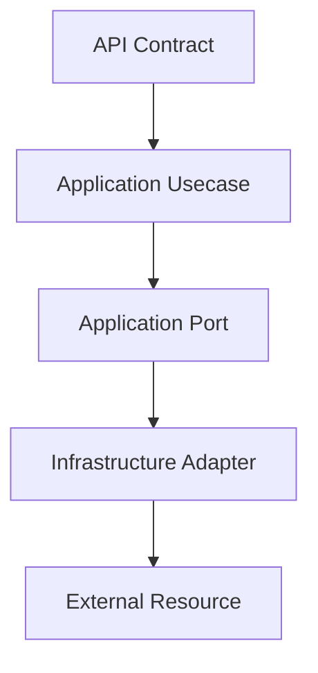

# 编码约定

## 1. 文档目的
说明当前项目编码边界和已有规范链接。

**最后更新范围**：覆盖当前目录约定、核心开发流程和必须同步更新的文档。

## 2. 适用读者
- 新人开发者
- 后端开发者
- 测试维护者

## 3. 关联源码
| 路径 | 作用 |
| --- | --- |
| `src/api/endpoint_*` | API 模块。 |
| `src/application` | 用例层。 |
| `src/application/ports` | 端口。 |
| `src/infrastructure` | 运行时组件。 |
| `config` | 配置。 |
| `test` | 测试。 |
| `docs/standard` | 已有编码/命名/测试规范。 |

## 4. 核心结论
- 本项目代码优先遵循 `/docs/standard/编码规范.md`：Python 3.11+、现代类型标注、稳定结构使用 Pydantic/dataclass/TypedDict。
- 分层边界必须清晰：`src/api` 不写业务规则，`src/application` 不依赖 `src/infrastructure`，`src/domain` 保持领域常量/策略和错误语义，`src/infrastructure` 承接外部资源。
- 配置、API 契约、端口契约和持久化模型都应使用可校验结构，避免 `dict[str, Any]` 成为长期协议。
- 异常、日志、测试说明使用中文；正式日志不要使用 `print`。

## 5. 结构说明
开发流程以真实代码边界为准，历史执行方案只作参考。

## 6. 工作流程

## 7. 关键实现
| 组件 | 文件 | 职责 |
| --- | --- | --- |
| `WebModuleManifestRegistry` | `src/api/web_module_manifest.py` | API 模块注册。 |
| `FastApiAppAssembler._build_application_container` | `src/api/fastapi_app_assembler.py` | 用例注入。 |
| `AppSettingsLoader` | `src/infrastructure/settings/app_settings_loader.py` | 配置模型。 |
| `ResponseEnvelope` | `src/core/http_contract/response_envelope_contract.py` | HTTP 响应统一信封。 |
| `ApplicationPortEnvelope` | `src/application/ports/application_port_contract.py` | 应用端口契约。 |
| `OrmModelBase` | `src/infrastructure/persistence/sqlalchemy_metadata_registry.py` | ORM 模型基类和元数据。 |

## 8. 如何修改或扩展
1. 新增稳定输入/输出结构时，外部协议用 Pydantic `BaseModel`，内部轻量对象用 `@dataclass(slots=True)`，必须保持字典协议时用 `TypedDict`。
2. 公共函数、类属性、返回值必须完整标注类型；使用 `list[T]`、`dict[K, V]`、`X | None`。
3. 编排函数只组织步骤，细节进入私有方法；不要为了“减少行数”机械拆函数。
4. 捕获异常只捕获可处理的具体异常；不要吞异常，不用泛化的 `except Exception` 掩盖错误。
5. API、配置、迁移、运行时组件修改必须同时检查契约、配置、测试和文档入口。
6. 代码注释只解释非显然约束、兼容性或危险边界，不重复代码本身。

## 9. 测试覆盖
| 测试类型 | 文件 | 验证内容 |
| --- | --- | --- |
| unit | `test/unit_test/**` | 纯逻辑、端口实现、模型转换。 |
| path | `test/path_test/**` | 配置、执行桥和分支路径。 |
| contract | `test/contract_test/**` | API、任务、运行时和端口契约。 |
| interface | `test/interface_test/**` | HTTP/CLI 对外行为。 |
| initialization | `test/initialization_test/**` | 启动、配置和资源装配。 |

## 10. 常见问题
- 如果一个改动需要跨多个层级，优先拆成 contract/usecase/adapter/API/test 小步。

## 11. 维护备注
开发指南变更时同步 README 高频任务入口。

## 12. 相关文档
- [项目文档总览](../README.md)
- [编码规范](../../standard/编码规范.md)
- [命名规范](../../standard/命名规范.md)
- [测试规范](../../standard/测试规范.md)
