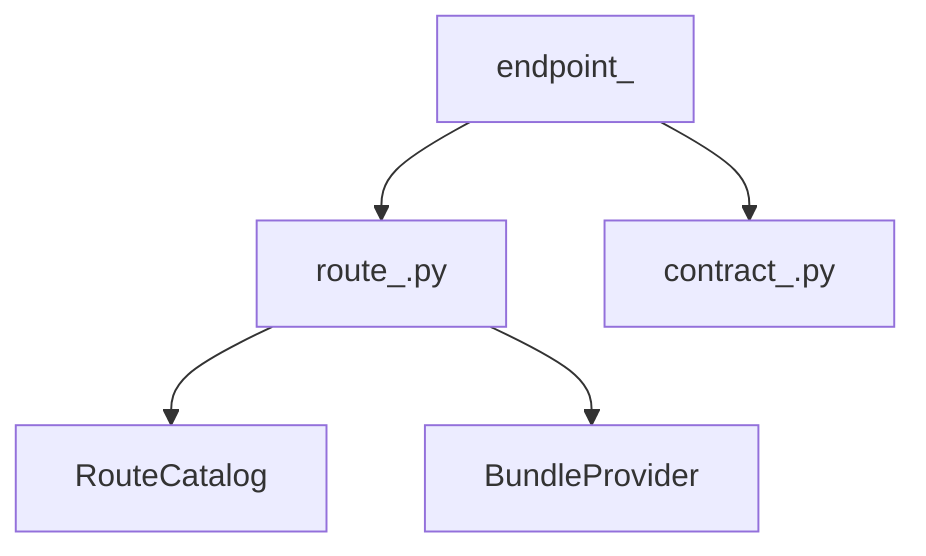

# 命名约定

## 1. 文档目的
说明 RouteCatalog、Usecase、Port、Contract 等命名模式。

**最后更新范围**：覆盖当前目录约定、核心开发流程和必须同步更新的文档。

## 2. 适用读者
- 新人开发者
- 后端开发者
- 测试维护者

## 3. 关联源码
| 路径 | 作用 |
| --- | --- |
| `src/api/endpoint_*` | API 模块。 |
| `src/application` | 用例层。 |
| `src/application/ports` | 端口。 |
| `src/infrastructure` | 运行时组件。 |
| `config` | 配置。 |
| `test` | 测试。 |
| `docs/standard` | 已有编码/命名/测试规范。 |

## 4. 核心结论
- 文件使用小写 snake_case，并按职责加后缀：`route_*`、`contract_*`、`*_usecase`、`*_port`、`*_adapter`、`*_repository_impl`、`*_orm_model`。
- 类型使用 PascalCase，并保留当前项目后缀：`<Module>RouteCatalog`、`<Module>BundleProvider`、`<Action><Subject>Usecase`、`<Capability>Port`、`<Entity>OrmModel`。
- 函数/方法使用具体动作词；用例入口使用 `execute`，读取依赖使用 `read_*`，构建对象使用 `build_*`，校验使用 `validate_*`。
- 配置目录和文件保持 `<name>_runtime/<name>_runtime_*.toml`、`<name>_module/<name>_module_*.toml`；Alembic revision 保持 `YYYYMMDDHHMM_描述.py`。

## 5. 结构说明
开发流程以真实代码边界为准，历史执行方案只作参考。

## 6. 工作流程

## 7. 关键实现
| 组件 | 文件 | 职责 |
| --- | --- | --- |
| `WebModuleManifestRegistry` | `src/api/web_module_manifest.py` | API 模块注册。 |
| `FastApiAppAssembler._build_application_container` | `src/api/fastapi_app_assembler.py` | 用例注入。 |
| `AppSettingsLoader` | `src/infrastructure/settings/app_settings_loader.py` | 配置模型。 |
| `ApplicationModuleName` | `src/core/http_contract/web_bundle_contract.py` | Web 模块名枚举。 |
| `ApplicationContainer` | `src/api/fastapi_app_assembler.py` | 用例字段名事实源。 |
| `DependencyContextAccessor` | `src/api/dependency_context_accessor.py` | `read_*_usecase` 方法命名事实源。 |

## 8. 如何修改或扩展
1. 新 API 模块名先进入 `ApplicationModuleName`，值使用 snake_case，并与 `endpoint_<module>`、manifest `module_name`、`app.modules.enabled` 保持一致。
2. 路由类命名为 `<Module>RouteCatalog`，Provider 命名为 `<Module>BundleProvider`；route tag 使用模块语义的 snake_case。
3. 用例按动作命名：查询使用 `List/Get/Read`，命令使用 `Create/Update/Delete/Apply/Dispatch/Release`，避免 `Manage`、`Helper`、`Common`。
4. 端口命名为 `<Capability>Port`；如果端口只服务单个用例，可先放在用例文件中，稳定后再迁入 `src/application/ports`。
5. 配置字段使用 snake_case，并与 TOML、Raw 映射、Settings 模型字段一致；环境变量使用大写 snake case。
6. 数据库对象常量使用表意名，如 `<ENTITY>_TABLE_NAME`、`<FIELD>_COLUMN_NAME`、`<INDEX>_INDEX_NAME`。

## 9. 测试覆盖
| 测试类型 | 文件 | 验证内容 |
| --- | --- | --- |
| unit | `test/unit_test/test_web_module_manifest_unit.py` | 模块名、provider 和 manifest 一致。 |
| contract | `test/contract_test/**` | 契约字段、kind、schema_version 命名。 |
| path | `test/path_test/**` | 配置字段路径和 API 前缀归一化。 |
| convention | `test/convention_usage_test/test_end_to_end_usage.py` | 项目级用法约定。 |

## 10. 常见问题
- 如果一个改动需要跨多个层级，优先拆成 contract/usecase/adapter/API/test 小步。

## 11. 维护备注
开发指南变更时同步 README 高频任务入口。

## 12. 相关文档
- [项目文档总览](../README.md)
- [编码规范](../../standard/编码规范.md)
- [命名规范](../../standard/命名规范.md)
- [测试规范](../../standard/测试规范.md)
