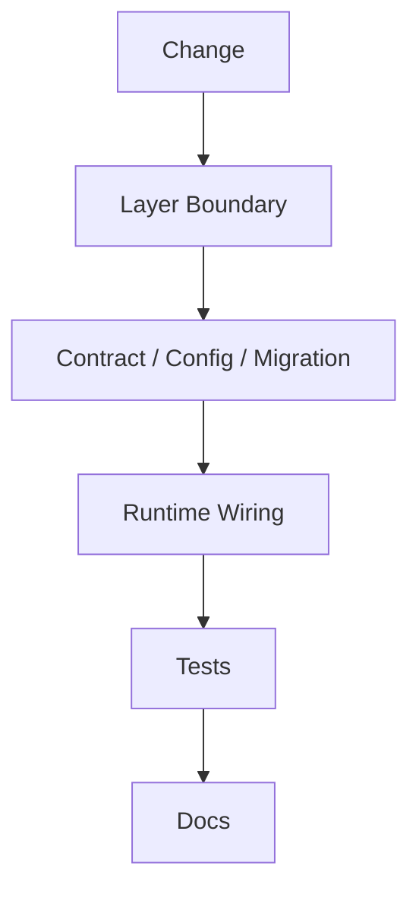

# 评审清单

## 1. 文档目的
给出代码和文档评审检查项。

**最后更新范围**：覆盖当前目录约定、核心开发流程和必须同步更新的文档。

## 2. 适用读者
- 新人开发者
- 后端开发者
- 测试维护者

## 3. 关联源码
| 路径 | 作用 |
| --- | --- |
| `src/api/endpoint_*` | API 模块。 |
| `src/application` | 用例层。 |
| `src/application/ports` | 端口。 |
| `src/infrastructure` | 运行时组件。 |
| `config` | 配置。 |
| `test` | 测试。 |
| `docs/standard` | 已有编码/命名/测试规范。 |

## 4. 核心结论
- 评审优先以当前代码为准：先检查真实调用链是否接通，再检查文档和说明是否同步。
- 新增 API 重点查 `contract`、`route`、`BundleProvider`、manifest、模块启用配置、鉴权边界和接口测试。
- 新增用例重点查端口依赖、容器注入、`DependencyContextAccessor` 接线和单元/异常/边界测试。
- 新增配置、运行时组件或迁移时，必须查生产安全约束、热更新策略、资源生命周期和数据库升级路径。

## 5. 结构说明
开发流程以真实代码边界为准，历史执行方案只作参考。

## 6. 工作流程

## 7. 关键实现
| 组件 | 文件 | 职责 |
| --- | --- | --- |
| `WebModuleManifestRegistry` | `src/api/web_module_manifest.py` | API 模块注册。 |
| `WebBundleCatalog` | `src/api/web_bundle_catalog.py` | provider 导入和模块启用校验。 |
| `DependencyContextAccessor` | `src/api/dependency_context_accessor.py` | route 到容器依赖的读取边界。 |
| `FastApiAppAssembler._build_application_container` | `src/api/fastapi_app_assembler.py` | 用例注入。 |
| `AppSettingsLoader` | `src/infrastructure/settings/app_settings_loader.py` | 配置模型。 |
| `SharedResourceMount` | `src/infrastructure/shared_resource_mount.py` | 运行时资源、端口实现和生命周期。 |
| `AlembicRunner` | `src/infrastructure/persistence/alembic_runner.py` | 数据库迁移执行入口。 |

## 8. 如何修改或扩展
1. 层级边界：`src/application` 是否只依赖端口和领域对象，未直接导入基础设施实现；route 是否没有塞入业务规则。
2. API：`response_model`、`ResponseEnvelope[...]`、鉴权依赖、错误码、`api_prefix`、`app.modules.enabled` 是否都有测试覆盖。
3. 用例：构造函数依赖是否最小；`execute` 输入输出是否清晰；失败语义是异常还是结果对象是否明确。
4. 配置：base 与各环境层差异是否明确；`.env`、进程环境变量、production 安全校验和热更新路径是否同步。
5. 运行时：资源创建、健康状态、配置应用、释放和日志是否集中在 `SharedResourceMount` 及相关组件。
6. 迁移：ORM、repository、Alembic revision、数据修复、downgrade 和迁移集成测试是否一起改。
7. 文档：只更新与行为变化直接相关的 `/docs/project_manual` 和 `/docs/standard` 链接，不用文档掩盖代码缺口。

## 9. 测试覆盖
| 测试类型 | 文件 | 验证内容 |
| --- | --- | --- |
| unit | `test/unit_test/**` | 纯逻辑、端口实现、manifest 和资源生命周期。 |
| path | `test/path_test/**` | 配置路径、执行路径和分支路径。 |
| exception | `test/exception_test/**` | 异常输入、依赖失败和错误转换。 |
| boundary | `test/boundary_test/**` | 长度、数量、状态、分页和约束边界。 |
| contract | `test/contract_test/**` | HTTP、任务、运行时和持久化契约。 |
| interface | `test/interface_test/**` | 对外接口可用性、鉴权和状态码。 |
| integration | `test/integration_test/**` | 数据库、缓存、消息和迁移联动。 |

## 10. 常见问题
- 如果一个改动需要跨多个层级，优先拆成 contract/usecase/adapter/API/test 小步。

## 11. 维护备注
开发指南变更时同步 README 高频任务入口。

## 12. 相关文档
- [项目文档总览](../README.md)
- [编码规范](../../standard/编码规范.md)
- [命名规范](../../standard/命名规范.md)
- [测试规范](../../standard/测试规范.md)
