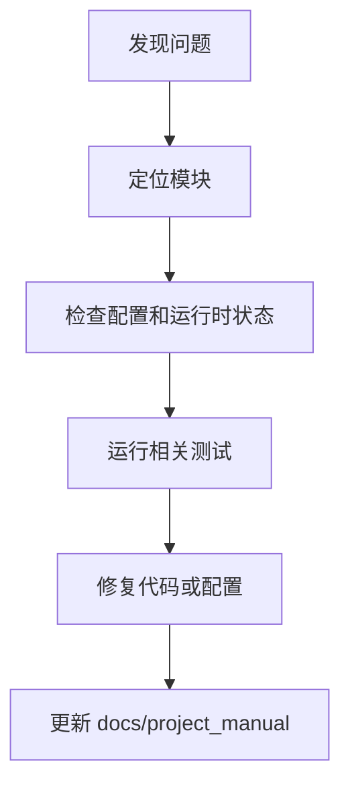

# 变更记录

- 2026-07-19：生产级整改正式收口。确认代码基线 `66dbff1e9756...9dffc0` 与最终 TestRun 一致，P0/P1 open 为零；将 13 个 P1 `fixed` 明确为旧版历史不可复验导致的证据成熟度差异，而非当前未修复缺陷。新增业务开发增量门禁、文档回归和停止重复审查规则。

## 1. 文档目的
记录项目说明书生成与后续维护记录。

**最后更新范围**：覆盖当前已确认故障来源和维护同步规则。

## 2. 适用读者
- 新人开发者
- 后端开发者
- 测试维护者
- 运维部署人员
- 安全审查人员

## 3. 关联源码
| 路径 | 作用 |
| --- | --- |
| `src/infrastructure/settings/settings_security_validator.py` | 生产安全校验。 |
| `src/infrastructure/shared_resource_mount.py` | 运行时资源状态。 |
| `src/infrastructure/fastapi_lifespan_orchestrator.py` | 启动/停止。 |
| `test` | 回归测试。 |
| `docs/project_manual` | 当前说明书。 |

## 4. 核心结论
- 启动失败优先看配置、外部服务健康和迁移。
- 鉴权失败优先看 token、角色 `admin` 和 scope。
- 生产配置失败通常来自必需环境变量缺失或密钥弱。
- 文档维护必须以当前代码为准。

## 5. 结构说明
维护流程从症状定位到配置/代码/测试证据，再回写说明书。

## 6. 工作流程

## 7. 关键实现
| 组件 | 文件 | 职责 |
| --- | --- | --- |
| `SettingsSecurityValidator` | `src/infrastructure/settings/settings_security_validator.py` | 生产配置故障。 |
| `SharedResourceMount.get_runtime_states` | `src/infrastructure/shared_resource_mount.py` | 运行时状态读取。 |
| `HealthProbeRouteCatalog.get_ready` | `src/api/endpoint_health_probe/route_health_probe.py` | ready 探针。 |

## 8. 如何修改或扩展
1. 先复现并记录环境。
2. 检查对应配置、route/usecase/runtime 和测试。
3. 修复后运行相关测试。
4. 更新本维护章节和相关专题文档。

## 9. 测试覆盖
| 测试类型 | 文件 | 验证内容 |
| --- | --- | --- |
| exception | `test/exception_test/test_runtime_exception.py` | 运行时异常。 |
| initialization | `test/initialization_test/test_runtime_initialization.py` | 初始化。 |
| integration | `test/integration_test/test_security_production_integration.py` | 生产安全。 |

## 10. 常见问题
- 待确认：实际生产日志聚合、告警规则和 Grafana dashboard 由部署环境决定。

## 11. 维护备注
维护说明变更时同步 README 高频任务和相关专题文档。

### 当前说明书变更记录

- 2026-07-16：完成当前基线复核。生产任务硬迁移为 `task_execution_probe`；CI 增加 PostgreSQL、带认证 Redis、RabbitMQ 健康服务；TestRun/Regression/Documentation 接入内容级真实证据存储与索引；autotuner 三轮结论维持 rejected；production Compose 完成隔离验证。最终真实依赖回归 797 passed、225 warnings，总体组合覆盖率 90.7986%。
- 2026-07-13：完成生产级全量审查硬迁移。真实依赖全量回归 722 passed，总体 line/branch 组合覆盖率 92.05%，四个关键域均不低于 90%；生产镜像、迁移、最小权限、停机恢复和稳定/突发/过载/退化/多实例场景通过。修复只读镜像入口配置、RabbitMQ 监听就绪竞态和 Redis 退化 500；autotuner 无稳定晋升项，保持冻结容量配置。
- 2026-06-22：审查 `10_maintenance` 六篇维护文档，对齐 `SettingsSecurityValidator`、`RuntimeResourceBootstrapper`、日志缓冲/脱敏、Prometheus 指标、任务运行时、SQLAlchemy/Alembic、Docker/Compose 和相关测试；补充生产安全基线、RabbitMQ/Redis/ready 探针、日志和性能维护说明。
- 2026-06-21：基于当前代码生成 `/docs/project_manual` 项目说明书首版。

## 12. 相关文档
- [项目文档总览](../README.md)
- [运维检查清单](../07_configuration_deployment/operations_checklist.md)
