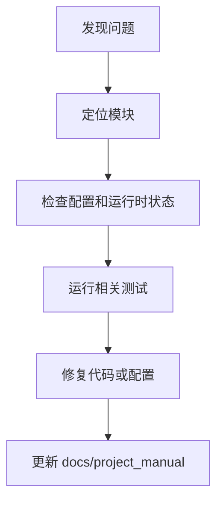

# 常见失败模式

## 1. 文档目的
列出当前代码和配置可确认的常见失败。

**最后更新范围**：覆盖当前已确认故障来源和维护同步规则。

## 2. 适用读者
- 新人开发者
- 后端开发者
- 测试维护者
- 运维部署人员
- 安全审查人员

## 3. 关联源码
| 路径 | 作用 |
| --- | --- |
| `src/infrastructure/settings/settings_security_validator.py` | 生产安全校验。 |
| `src/infrastructure/shared_resource_mount.py` | 运行时资源状态。 |
| `src/infrastructure/resource_mount/runtime_resource_bootstrapper.py` | 运行时资源启动和任务/消息拓扑校验。 |
| `src/infrastructure/security/**` | 限流、IP 封禁、Token-IP 绑定和出站 URL 防护。 |
| `src/infrastructure/logging/**` | 日志落库、缓冲和脱敏。 |
| `src/infrastructure/persistence/**` | 数据库连接、迁移和 ORM 表。 |
| `src/infrastructure/fastapi_lifespan_orchestrator.py` | 启动/停止。 |
| `Dockerfile`、`compose*.yml` | 容器依赖、健康检查和生产环境覆盖。 |
| `test` | 回归测试。 |
| `docs/project_manual` | 当前说明书。 |

## 4. 核心结论
- 启动失败优先看配置、外部服务健康和迁移。
- 鉴权失败优先看 token、角色 `admin` 和 scope。
- 生产配置失败通常来自必需环境变量缺失或密钥弱。
- 任务运行时启动失败时，重点检查 local/funboost task backend 与 local/RabbitMQ message backend 是否匹配。
- 生产安全基线还会拦截 OpenAPI 暴露、CORS 通配符、常驻 bootstrap admin、内存缓存鉴权节流、无密码 Redis、`guest/guest` RabbitMQ。
- 限流和 IP 封禁依赖缓存；缓存不可用时 `RateLimitMiddleware` 把中间件链内缓存故障转换为统一 503 fail-closed 响应，不泄漏为 500。
- 文档维护必须以当前代码为准。

## 5. 结构说明
维护流程从症状定位到配置/代码/测试证据，再回写说明书。

## 6. 工作流程

## 7. 关键实现
| 组件 | 文件 | 职责 |
| --- | --- | --- |
| `SettingsSecurityValidator` | `src/infrastructure/settings/settings_security_validator.py` | 生产配置故障。 |
| `SharedResourceMount.get_runtime_states` | `src/infrastructure/shared_resource_mount.py` | 运行时状态读取。 |
| `RuntimeResourceBootstrapper._validate_task_message_topology` | `src/infrastructure/resource_mount/runtime_resource_bootstrapper.py` | 拦截 local task + RabbitMQ message 组合。 |
| `SettingsSecurityValidator._validate_task_runtime_consistency` | `src/infrastructure/settings/settings_security_validator.py` | 校验 funboost 与 RabbitMQ、exchange 和 broker_kind 一致性。 |
| `RateLimitGuard.evaluate` | `src/infrastructure/security/rate_limit_guard.py` | 限流缓存不可用时返回缓存不可用故障。 |
| `DatabaseLogWriter.write_batch` | `src/infrastructure/logging/database_log_writer.py` | 日志落库失败时按配置降级 stdout。 |
| `HealthProbeRouteCatalog.get_ready` | `src/api/endpoint_health_probe/route_health_probe.py` | ready 探针。 |

## 8. 如何修改或扩展
1. 先复现并记录环境。
2. 检查对应配置、route/usecase/runtime 和测试。
3. 修复后运行相关测试。
4. 更新本维护章节和相关专题文档。

## 9. 测试覆盖
| 测试类型 | 文件 | 验证内容 |
| --- | --- | --- |
| exception | `test/exception_test/test_runtime_exception.py` | 运行时异常。 |
| exception | `test/exception_test/test_security_protection_exception.py` | 限流缓存不可用。 |
| initialization | `test/initialization_test/test_runtime_initialization.py` | 初始化。 |
| unit | `test/unit_test/test_settings_security_unit.py` | 生产环境拦截规则。 |
| unit | `test/unit_test/test_rabbitmq_message_gateway_unit.py` | RabbitMQ URL 与 vhost 处理。 |
| integration | `test/integration_test/test_security_production_integration.py` | 生产安全。 |
| integration | `test/integration_test/test_security_ip_block_integration.py` | IP 封禁缓存与数据库同步。 |

## 10. 常见问题
- 待确认：实际生产日志聚合、告警规则和 Grafana dashboard 由部署环境决定。
- 生产环境如出现 “producer-only” 任务拓扑错误，检查 production 任务后端是否仍为 funboost、默认任务类型是否为 `task_execution_probe`，以及当前后端是否存在启用任务声明。
- 生产启动报缺少 `DATABASE_URL`、`REDIS_URL`、`RABBITMQ_URL` 或 `JWT_SECRET`：这是 `AppSettingsLoader` 加载生产环境时的硬校验，不应从默认配置兜底。
- 生产 Redis 无密码、RabbitMQ 使用 `guest/guest`、OpenAPI/CORS 通配符/bootstrap admin 未关闭：均属于当前代码确认的启动失败模式。
- RabbitMQ 发布或探测失败：消息地址必须是 `amqp://` 或 `amqps://`，root vhost 在 Compose 中使用 `%2F` 编码。
- 日志落库失败：若 `fallback_to_stdout = true`，失败事件会脱敏后输出到 logger；同时检查 `app_log_record` 表迁移。

## 11. 维护备注
维护说明变更时同步 README 高频任务和相关专题文档。

## 12. 相关文档
- [项目文档总览](../README.md)
- [运维检查清单](../07_configuration_deployment/operations_checklist.md)
