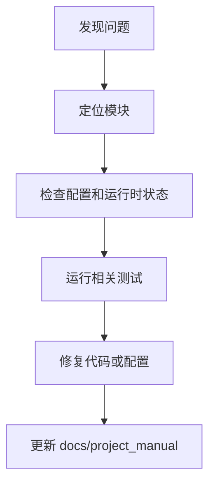

# 文档维护

## 1. 文档目的
说明如何保持本说明书与代码一致。

**最后更新范围**：覆盖当前已确认故障来源和维护同步规则。

## 2. 适用读者
- 新人开发者
- 后端开发者
- 测试维护者
- 运维部署人员
- 安全审查人员

## 3. 关联源码
| 路径 | 作用 |
| --- | --- |
| `src/infrastructure/settings/settings_security_validator.py` | 生产安全校验。 |
| `src/infrastructure/shared_resource_mount.py` | 运行时资源状态。 |
| `src/infrastructure/fastapi_lifespan_orchestrator.py` | 启动/停止。 |
| `src/infrastructure/security/**`、`logging/**`、`observability/**`、`task/**`、`persistence/**` | 维护类文档的事实来源。 |
| `config/**`、`Dockerfile`、`compose*.yml`、`test/**` | 配置、部署和验证依据。 |
| `test` | 回归测试。 |
| `docs/project_manual` | 当前说明书。 |

## 4. 核心结论
- 启动失败优先看配置、外部服务健康和迁移。
- 鉴权失败优先看 token、角色 `admin` 和 scope。
- 生产配置失败通常来自必需环境变量缺失或密钥弱。
- 维护类文档以代码、配置和测试为准；`logs/**` 只能作为历史现象参考，不能替代当前实现。
- 生产告警、日志聚合和 Grafana dashboard 不在当前代码中固定，文档只能标注为部署环境决定。
- 变更记录只记录已核对的文档事实，不写未验证的发布说明或路线承诺。
- 文档维护必须以当前代码为准。

## 5. 结构说明
维护流程从症状定位到配置/代码/测试证据，再回写说明书。

## 6. 工作流程

## 7. 关键实现
| 组件 | 文件 | 职责 |
| --- | --- | --- |
| `SettingsSecurityValidator` | `src/infrastructure/settings/settings_security_validator.py` | 生产配置故障。 |
| `SharedResourceMount.get_runtime_states` | `src/infrastructure/shared_resource_mount.py` | 运行时状态读取。 |
| `HealthProbeRouteCatalog.get_ready` | `src/api/endpoint_health_probe/route_health_probe.py` | ready 探针。 |

## 8. 如何修改或扩展
1. 先复现并记录环境。
2. 检查对应配置、route/usecase/runtime 和测试。
3. 修复后运行相关测试。
4. 更新本维护章节和相关专题文档。
5. 对维护文档新增判断时，标明对应类、配置项或测试文件，避免只写泛化结论。

## 9. 测试覆盖
| 测试类型 | 文件 | 验证内容 |
| --- | --- | --- |
| exception | `test/exception_test/test_runtime_exception.py` | 运行时异常。 |
| initialization | `test/initialization_test/test_runtime_initialization.py` | 初始化。 |
| integration | `test/integration_test/test_security_production_integration.py` | 生产安全。 |

## 10. 常见问题
- 待确认：实际生产日志聚合、告警规则和 Grafana dashboard 由部署环境决定。
- 文档与代码冲突：以 `src/**`、`config/**`、`Dockerfile`、`compose*.yml` 和 `test/**` 的当前事实为准。
- 仅从日志看到的现象：先回到当前代码确认是否仍存在，再写入维护文档。
- 维护文档补充应保持短条目和可定位依据，不把故障排查扩展成完整设计文档。

## 11. 维护备注
维护说明变更时同步 README 高频任务和相关专题文档。

## 12. 相关文档
- [项目文档总览](../README.md)
- [运维检查清单](../07_configuration_deployment/operations_checklist.md)
