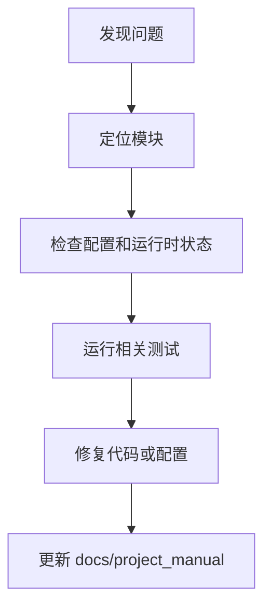

# 性能备注

## 1. 文档目的
说明同步桥接、连接池、缓存、日志缓冲和指标开销。

**最后更新范围**：覆盖当前已确认故障来源和维护同步规则。

## 2. 适用读者
- 新人开发者
- 后端开发者
- 测试维护者
- 运维部署人员
- 安全审查人员

## 3. 关联源码
| 路径 | 作用 |
| --- | --- |
| `src/infrastructure/settings/settings_security_validator.py` | 生产安全校验。 |
| `src/infrastructure/shared_resource_mount.py` | 运行时资源状态。 |
| `src/infrastructure/persistence/sqlalchemy_engine_factory.py` | 数据库连接池和健康检查。 |
| `src/infrastructure/logging/log_buffer_dispatcher.py` | 日志缓冲刷新策略。 |
| `src/infrastructure/observability/prometheus_metrics_registry.py` | Prometheus 指标采集。 |
| `src/infrastructure/task/local_task_dispatcher.py` | 本地任务同进程执行。 |
| `src/infrastructure/task/managed_funboost_thread_pool.py` | Funboost 消费任务的有界并发与确定性关闭。 |
| `src/infrastructure/fastapi_lifespan_orchestrator.py` | 启动/停止。 |
| `test` | 回归测试。 |
| `docs/project_manual` | 当前说明书。 |

## 4. 核心结论
- 启动失败优先看配置、外部服务健康和迁移。
- 鉴权失败优先看 token、角色 `admin` 和 scope。
- 生产配置失败通常来自必需环境变量缺失或密钥弱。
- 数据库默认连接池为 `pool_size = 5`、`max_overflow = 10`、`pool_recycle_seconds = 1800`、`connect_timeout_seconds = 5`，并启用 `pool_pre_ping`。
- 日志默认数据库落库，`buffer_max_items = 1000`、`max_batch_size = 100`、`flush_interval_seconds = 2`；时间窗口刷新发生在下一次 emit 或显式 flush。
- Prometheus 指标默认配置存在但 `enabled = false`；启用后记录低基数路由模板、状态码、耗时和 ready gauge。
- 本地任务默认 `inline_execute_enabled = true`，处理器耗时会进入请求路径；本地消息和失败任务记录均为内存上限 1000。
- 最终 10 秒稳定基线/复验分别为 10.08/9.72 rps、p50 19/20 ms、p95 41/45 ms，均为 0 错误；同基线 p95 变化 9.76%。
- 突发与过载分别达到 40.33/82.25 rps，无未处理 5xx；Redis 退化按 503 fail closed，恢复后服务健康。
- autotuner 三轮最优项不一致，本轮不晋升容量参数；保持 `max_workers=8`、`max_pending_requests=32`、`queue_wait_timeout_seconds=2`。
- 三轮 autotuner 原始记录位于 `test/performance/autotuner/runs/`，每轮使用唯一 run ID；活动报告不得覆盖历史轮次。
- 最终真实负载 CSV、HTML、33 条逐命令证据、10 次资源采样和 TestRun 记录位于 `docs/evidence/load/current-final/` 与 `docs/evidence/test-runs/phase3-final-load.json`。
- 文档维护必须以当前代码为准。

## 5. 结构说明
维护流程从症状定位到配置/代码/测试证据，再回写说明书。

## 6. 工作流程

## 7. 关键实现
| 组件 | 文件 | 职责 |
| --- | --- | --- |
| `SettingsSecurityValidator` | `src/infrastructure/settings/settings_security_validator.py` | 生产配置故障。 |
| `SharedResourceMount.get_runtime_states` | `src/infrastructure/shared_resource_mount.py` | 运行时状态读取。 |
| `SqlAlchemyEngineFactory.build` | `src/infrastructure/persistence/sqlalchemy_engine_factory.py` | 连接池、search_path 和连接超时。 |
| `LogBufferDispatcher.emit` | `src/infrastructure/logging/log_buffer_dispatcher.py` | 容量、批大小和时间窗口刷盘。 |
| `PrometheusHttpMetricsMiddleware.dispatch` | `src/infrastructure/observability/prometheus_metrics_route.py` | 请求耗时指标。 |
| `LocalTaskDispatcher.dispatch` | `src/infrastructure/task/local_task_dispatcher.py` | 本地 inline 执行与任务记录。 |
| `ManagedFunboostThreadPool.shutdown` | `src/infrastructure/task/managed_funboost_thread_pool.py` | 取消未开始任务并等待在途消费任务结束。 |
| `HealthProbeRouteCatalog.get_ready` | `src/api/endpoint_health_probe/route_health_probe.py` | ready 探针。 |

## 8. 如何修改或扩展
1. 先复现并记录环境。
2. 检查对应配置、route/usecase/runtime 和测试。
3. 修复后运行相关测试。
4. 更新本维护章节和相关专题文档。

## 9. 测试覆盖
| 测试类型 | 文件 | 验证内容 |
| --- | --- | --- |
| exception | `test/exception_test/test_runtime_exception.py` | 运行时异常。 |
| initialization | `test/initialization_test/test_runtime_initialization.py` | 初始化。 |
| unit | `test/unit_test/test_log_writer_unit.py` | 日志批量和时间窗口刷新。 |
| unit | `test/unit_test/test_prometheus_metrics_registry_unit.py` | 指标文本内容。 |
| unit | `test/unit_test/test_local_task_dispatcher_unit.py` | 本地任务派发与去重。 |
| unit | `test/unit_test/test_shared_async_http_client_unit.py` | 共享异步 HTTP 客户端。 |
| integration | `test/integration_test/test_security_production_integration.py` | 生产安全。 |
| integration | `test/integration_test/test_task_execution_record_integration.py` | 任务执行记录持久化。 |
| performance | `test/performance/scenarios/locustfile.py` | 稳定、突发、过载、退化与多实例负载入口。 |
| performance | `test/performance/autotuner/capacity_autotuner.py` | 参数搜索、候选/拒绝记录和晋升决策。 |

## 10. 常见问题
- 待确认：实际生产日志聚合、告警规则和 Grafana dashboard 由部署环境决定。
- 请求偶发变慢：先排查本地 inline 任务、同步用例桥接、数据库连接池耗尽和日志批量 flush。
- 指标开销评估：当前中间件使用路由模板降低标签基数，不应把原始 URL 参数作为指标标签补进去。
- 日志堆积：检查 `buffer_max_items`、`max_batch_size`、`flush_interval_seconds` 与数据库写入能力是否匹配。
- RabbitMQ 生产发布开启持久消息和 publisher confirm，延迟高时优先区分 broker 确认慢还是处理器慢。
- `task-worker` 可独立扩容；扩容前同时检查 `consumer_worker_count`、prefetch、队列上限和数据库容量，避免只扩大消费者线程数。
- 健康探针负载不进入业务数据库池和任务队列，不能把本报告中的池等待、队列深度不适用解释为业务路径容量为零；业务发布应补充相应 SLO 场景。

## 11. 维护备注
维护说明变更时同步 README 高频任务和相关专题文档。

## 12. 相关文档
- [项目文档总览](../README.md)
- [运维检查清单](../07_configuration_deployment/operations_checklist.md)
- [生产性能真实验证报告](../../2026_7_13_生产性能真实验证报告.md)
