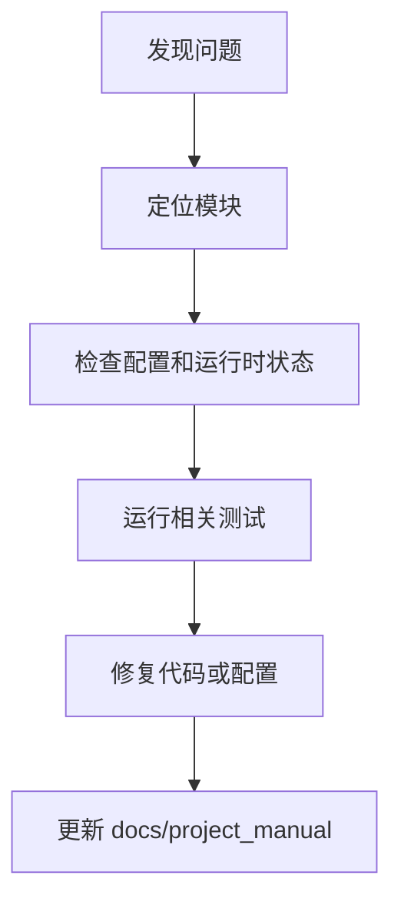

# 安全维护

## 1. 文档目的
说明密钥、权限、限流、IP 封禁和出站防护维护点。

**最后更新范围**：覆盖当前已确认故障来源和维护同步规则。

## 2. 适用读者
- 新人开发者
- 后端开发者
- 测试维护者
- 运维部署人员
- 安全审查人员

## 3. 关联源码
| 路径 | 作用 |
| --- | --- |
| `src/infrastructure/settings/settings_security_validator.py` | 生产安全校验。 |
| `src/infrastructure/shared_resource_mount.py` | 运行时资源状态。 |
| `src/infrastructure/security/rate_limit_guard.py` | 限流缓存键和 fail closed 行为。 |
| `src/infrastructure/security/ip_block_guard.py` | IP 封禁缓存、数据库和分布式锁。 |
| `src/infrastructure/security/outbound_url_safety_validator.py` | 出站 URL / SSRF 防护。 |
| `src/infrastructure/security/token_binding_guard.py` | Token-IP 绑定。 |
| `src/infrastructure/logging/sensitive_text_redactor.py` | 敏感日志脱敏。 |
| `src/infrastructure/fastapi_lifespan_orchestrator.py` | 启动/停止。 |
| `test` | 回归测试。 |
| `docs/project_manual` | 当前说明书。 |

## 4. 核心结论
- 启动失败优先看配置、外部服务健康和迁移。
- 鉴权失败优先看 token、角色 `admin` 和 scope。
- 生产配置失败通常来自必需环境变量缺失或密钥弱。
- 生产安全基线强制外部 `JWT_SECRET`、`DATABASE_URL`、`REDIS_URL`、`RABBITMQ_URL`，并要求 Redis 带密码、RabbitMQ 禁止 `guest/guest`。
- 生产环境必须关闭 OpenAPI 暴露、匿名系统信息、CORS 通配符和常驻 bootstrap admin，并使用分布式鉴权节流。
- 限流、IP 封禁和 Token-IP 绑定只保存摘要或缓存键；排查时不要依赖原始 token、IP 或密码进入日志。
- 出站 URL 防护会拒绝非法 scheme/port、空 host、localhost、私有地址、链路本地地址、保留地址、元数据地址和生产环境未在目的域名允许清单中声明的 host。
- 供应链门禁由 Nox static 执行 Bandit 和 pip-audit；本轮已将存在 `PYSEC-2026-3447` 的 `setuptools 82.0.1` 升级到 83.0.0，当前无已知漏洞。
- 文档维护必须以当前代码为准。

## 5. 结构说明
维护流程从症状定位到配置/代码/测试证据，再回写说明书。

## 6. 工作流程

## 7. 关键实现
| 组件 | 文件 | 职责 |
| --- | --- | --- |
| `SettingsSecurityValidator` | `src/infrastructure/settings/settings_security_validator.py` | 生产配置故障。 |
| `SharedResourceMount.get_runtime_states` | `src/infrastructure/shared_resource_mount.py` | 运行时状态读取。 |
| `ClientIpResolver` | `src/infrastructure/security/client_ip_resolver.py` | 仅在远端地址命中显式可信代理 CIDR 时读取转发 IP；生产默认不信任任何代理头。 |
| `IpBlockGuard` | `src/infrastructure/security/ip_block_guard.py` | 封禁记录落库、缓存回填和释放缓存。 |
| `RateLimitGuard` | `src/infrastructure/security/rate_limit_guard.py` | 按 IP、主体、路径方法或认证字段摘要限流。 |
| `TokenBindingGuard` | `src/infrastructure/security/token_binding_guard.py` | 首次未绑定时写入 Token-IP 绑定，后续不匹配时失败。 |
| `OutboundUrlSafetyValidator` | `src/infrastructure/security/outbound_url_safety_validator.py` | SSRF 出站目标校验。 |
| `SensitiveTextRedactor` | `src/infrastructure/logging/sensitive_text_redactor.py` | URL 凭据、Bearer/JWT 和 key-value 密钥脱敏。 |
| `HealthProbeRouteCatalog.get_ready` | `src/api/endpoint_health_probe/route_health_probe.py` | ready 探针。 |

## 8. 如何修改或扩展
1. 先复现并记录环境。
2. 检查对应配置、route/usecase/runtime 和测试。
3. 修复后运行相关测试。
4. 更新本维护章节和相关专题文档。

## 9. 测试覆盖
| 测试类型 | 文件 | 验证内容 |
| --- | --- | --- |
| exception | `test/exception_test/test_runtime_exception.py` | 运行时异常。 |
| exception | `test/exception_test/test_security_protection_exception.py` | 安全防护缓存异常。 |
| initialization | `test/initialization_test/test_runtime_initialization.py` | 初始化。 |
| unit | `test/unit_test/test_rate_limit_guard_unit.py` | 限流维度。 |
| unit | `test/unit_test/test_ip_block_guard_unit.py` | IP 封禁缓存/数据库逻辑。 |
| unit | `test/unit_test/test_token_binding_guard_unit.py` | Token-IP 绑定。 |
| unit | `test/unit_test/test_outbound_url_safety_validator_unit.py` | 出站 URL 防护。 |
| unit | `test/unit_test/test_sensitive_text_redactor_unit.py` | 日志脱敏。 |
| integration | `test/integration_test/test_security_production_integration.py` | 生产安全。 |
| integration | `test/integration_test/test_security_ip_block_integration.py` | IP 封禁 Redis 与数据库同步。 |

## 10. 常见问题
- 待确认：实际生产日志聚合、告警规则和 Grafana dashboard 由部署环境决定。
- 请求被 429：先区分 `security.ip_blocked` 与 `security.rate_limited`，再检查缓存可用性、封禁表和限流窗口。
- 请求返回 503 且错误码为缓存不可用：检查 Redis 健康和连接配置；生产 fail-closed 会拒绝请求，依赖恢复后无需重启应用即可恢复。
- `X-Forwarded-For` 未生效：当前解析器只在直连远端属于可信代理 CIDR 时读取转发头；production 的 `trusted_proxy_cidr_blocks` 默认为空，必须显式配置真实边界代理，并由边界代理 strip/overwrite 转发头。
- Token-IP 校验异常：首次请求会创建绑定，后续客户端 IP 变化会导致不匹配。
- 出站 HTTP 被拒绝：查看拒绝 reason code，如 `ssrf.invalid_scheme`、`ssrf.blocked_host`、`ssrf.host_not_allowed` 或 `ssrf.invalid_port`。
- `task-worker` 因弱密钥无法启动：这是 production fail-closed；应通过部署系统注入正式密钥，不得改低 `SettingsSecurityValidator` 约束。

## 11. 维护备注
维护说明变更时同步 README 高频任务和相关专题文档。

## 12. 相关文档
- [项目文档总览](../README.md)
- [运维检查清单](../07_configuration_deployment/operations_checklist.md)
