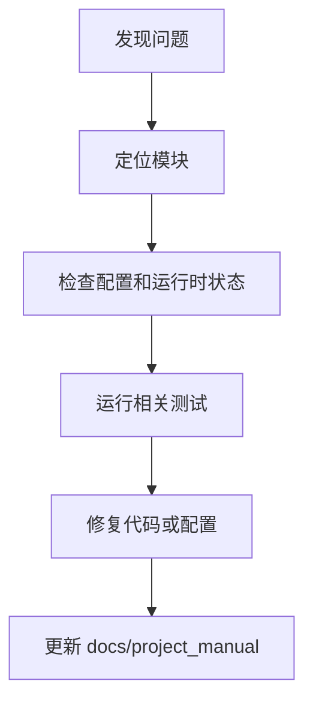

# 故障排查

## 1. 文档目的
提供启动、鉴权、数据库、缓存、任务、日志和指标的排查入口。

**最后更新范围**：覆盖当前已确认故障来源和维护同步规则。

## 2. 适用读者
- 新人开发者
- 后端开发者
- 测试维护者
- 运维部署人员
- 安全审查人员

## 3. 关联源码
| 路径 | 作用 |
| --- | --- |
| `src/infrastructure/settings/settings_security_validator.py` | 生产安全校验。 |
| `src/infrastructure/shared_resource_mount.py` | 运行时资源状态。 |
| `src/infrastructure/resource_mount/runtime_resource_bootstrapper.py` | 运行时资源启动、RabbitMQ 探测和任务/消息拓扑校验。 |
| `src/infrastructure/fastapi_lifespan_orchestrator.py` | 启动/停止。 |
| `src/infrastructure/logging/log_buffer_dispatcher.py` | 日志缓冲刷新。 |
| `src/infrastructure/observability/prometheus_metrics_route.py` | Prometheus 指标路由。 |
| `Dockerfile`、`compose*.yml` | 容器健康检查和依赖服务编排。 |
| `test` | 回归测试。 |
| `docs/project_manual` | 当前说明书。 |

## 4. 核心结论
- 启动失败优先看配置、外部服务健康和迁移。
- 鉴权失败优先看 token、角色 `admin` 和 scope。
- 生产配置失败通常来自必需环境变量缺失或密钥弱。
- `Dockerfile` 健康检查调用带 API 前缀的严格 `/health/ready`；进程存活但依赖未就绪时该端点返回 503，`/health/live` 只用于区分进程存活。
- 生产必须注入 `DATABASE_URL`、`REDIS_URL`、`RABBITMQ_URL` 和 `JWT_SECRET`；普通 `compose.yml` 的 app 未注入 `REDIS_URL`，开发环境仍按配置使用内存缓存。
- RabbitMQ 启动探测失败会记录任务失败并中断运行时资源启动。
- 文档维护必须以当前代码为准。

## 5. 结构说明
维护流程从症状定位到配置/代码/测试证据，再回写说明书。

## 6. 工作流程

## 7. 关键实现
| 组件 | 文件 | 职责 |
| --- | --- | --- |
| `SettingsSecurityValidator` | `src/infrastructure/settings/settings_security_validator.py` | 生产配置故障。 |
| `SharedResourceMount.get_runtime_states` | `src/infrastructure/shared_resource_mount.py` | 运行时状态读取。 |
| `RuntimeResourceBootstrapper._apply_message_runtime_state` | `src/infrastructure/resource_mount/runtime_resource_bootstrapper.py` | RabbitMQ 启动探测与失败记录。 |
| `LogBufferDispatcher.emit` / `flush` | `src/infrastructure/logging/log_buffer_dispatcher.py` | 日志按容量、批大小或时间窗口刷新。 |
| `PrometheusMetricsRoute.read_metrics` | `src/infrastructure/observability/prometheus_metrics_route.py` | `/metrics` 输出和 ready 指标。 |
| `HealthProbeRouteCatalog.get_ready` | `src/api/endpoint_health_probe/route_health_probe.py` | ready 探针。 |

## 8. 如何修改或扩展
1. 先复现并记录环境。
2. 检查对应配置、route/usecase/runtime 和测试。
3. 修复后运行相关测试。
4. 更新本维护章节和相关专题文档。

## 9. 测试覆盖
| 测试类型 | 文件 | 验证内容 |
| --- | --- | --- |
| exception | `test/exception_test/test_runtime_exception.py` | 运行时异常。 |
| initialization | `test/initialization_test/test_runtime_initialization.py` | 初始化。 |
| unit | `test/unit_test/test_settings_security_unit.py` | 生产安全配置校验。 |
| unit | `test/unit_test/test_log_writer_unit.py` | 日志缓冲刷新。 |
| unit | `test/unit_test/test_prometheus_metrics_registry_unit.py` | Prometheus 指标文本。 |
| integration | `test/integration_test/test_security_production_integration.py` | 生产安全。 |
| integration | `test/integration_test/test_migration_job_integration.py` | 迁移作业与生产 Compose。 |

## 10. 常见问题
- 待确认：实际生产日志聚合、告警规则和 Grafana dashboard 由部署环境决定。
- `/health/live` 正常但 `/health/ready` 返回 503：优先查看 `app.state.ready`、共享资源状态和 `modules.system.ready_probe_enabled`。
- 指标路径无输出：`config/runtime/metrics_runtime/metrics_runtime_base.toml` 当前默认 `enabled = false`，只有启用后才挂载 `/metrics`。
- RabbitMQ 启动探测失败：检查 `RABBITMQ_URL` scheme、主机、vhost 编码和 `startup_probe_timeout_seconds`；失败会进入任务失败记录。
- 数据库启动失败：`SqlAlchemyEngineFactory.validate` 使用 `SELECT 1`，同时检查连接串、schema search_path、迁移是否能升级到 Alembic `head`。

## 11. 维护备注
维护说明变更时同步 README 高频任务和相关专题文档。

## 12. 相关文档
- [项目文档总览](../README.md)
- [运维检查清单](../07_configuration_deployment/operations_checklist.md)
