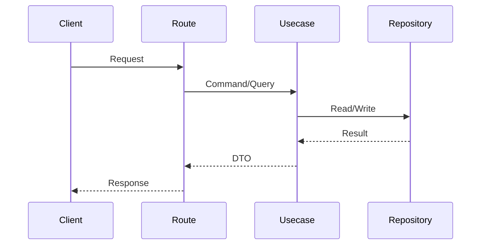

# API 名称

## 模板元信息
- 文档目的：提供新增同类文档时的稳定结构。
- 适用读者：后端开发者、测试维护者、运维部署人员、安全审查人员。
- 最后更新范围：仅覆盖 `/docs/project_manual/templates` 中的写作模板。
- 关联源码：模板不绑定单一源码文件，使用时必须替换为真实路径、类名、函数名、配置项和测试文件。
- 使用约束：只记录当前 route、contract、usecase、配置和测试可确认的事实，不保留占位符，不虚构业务行为。

## 1. API 目的

说明所属 `src/api/endpoint_*` 模块、是否在 manifest 中注册、是否默认启用，以及是否受 `runtime.web.api_prefix` 影响。

## 2. 路由入口

| 方法 | 路径 | 路由函数 | 文件 |
| ---- | ---- | -------- | ---- |
|      |      |          |      |

补充对应 contract 文件、usecase/port 和 `config/app_*.toml` 中的模块启用条件。

## 3. 请求参数

| 参数 | 位置 | 类型 | 是否必填 | 说明 |
| ---- | ---- | ---- | -------- | ---- |
|      |      |      |          |      |

## 4. 响应结构

引用 contract 文件中的真实模型，并说明是否包在统一 `ResponseEnvelope` / 业务 envelope 内。

## 5. 鉴权与权限

说明是否需要登录、角色、scope、token，后台接口需引用集中授权要求或对应 guard。

## 6. 业务流程

## 7. 错误码

| 错误码 | HTTP 状态 | 触发条件 | 来源 |
| ------ | --------- | -------- | ---- |
|        |           |          |      |

## 8. 测试用例

| 测试类型 | 测试文件 | 覆盖内容 |
| -------- | -------- | -------- |
|          |          |          |

## 9. 扩展注意事项

## 相关文档
- [项目文档总览](../README.md)
