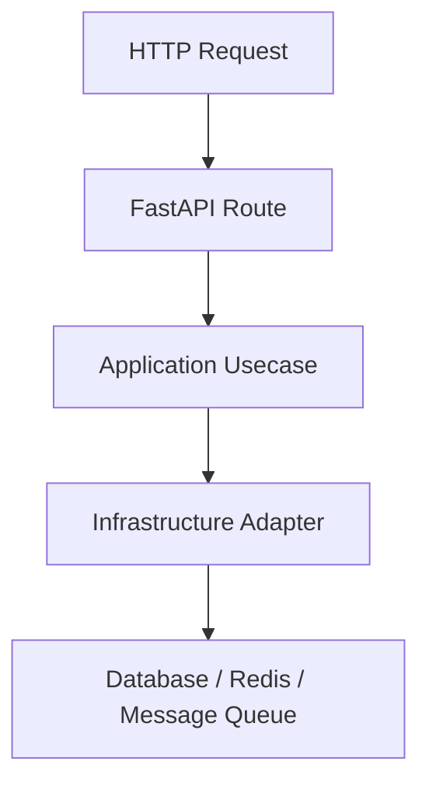
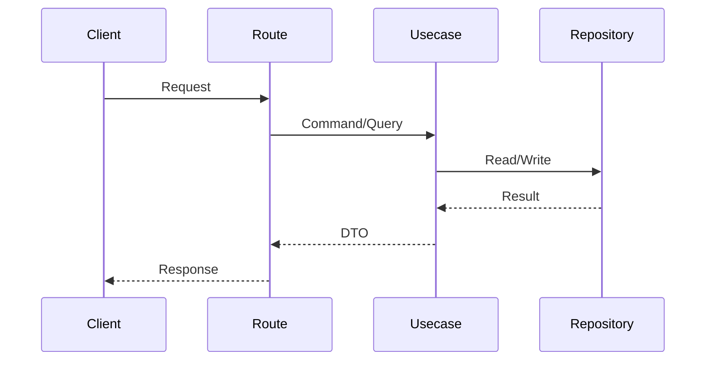

你是资深 FastAPI 项目文档架构师。请基于当前项目真实代码，为本项目在 `/docs/project_manual` 下生成一套“准确、易修改、可读、可导航、可持续维护”的项目文档。

重要要求：
1. 必须先阅读真实项目结构和代码，不能凭空编造。
2. 文档内容必须引用真实文件路径、类名、函数名、配置项、测试文件。
3. 如果某个模块无法从代码确认，请写“待确认”，不要猜测。
4. 文档面向后续开发者、维护者、接手者，既要说明“怎么用”，也要说明“为什么这样设计”。
5. 文档使用 Markdown。
6. 文档目录和文件名尽量稳定，便于长期维护。
7. 每个文档开头必须包含：文档目的、适用读者、最后更新范围、关联源码。
8. 所有文档之间要互相链接，入口统一放在 `/docs/project_manual/README.md`。
9. 保留已有 `/docs` 下的历史执行方案、规范、技术选型文档，不要删除、覆盖或迁移它们。
10. 新文档只放入 `/docs/project_manual`，作为“当前项目说明书”。

请根据当前项目设计文档结构。该项目是一个 Python 3.11+ FastAPI 后端项目，已观察到的关键结构包括：

- `src/main.py`：应用入口，调用 `src.api.asgi_entry.create_app`
- `src/api`：HTTP API、路由、契约、模块注册相关代码
- `src/application`：用例层、应用端口、后台管理用例
- `src/core`：核心契约，包括 auth、cache、http、task、security、logging、persistence、observability 等 contract
- `src/domain`：领域常量、错误码、权限角色等
- `src/infrastructure`：FastAPI 装配、配置加载、持久化、日志、缓存、任务、鉴权、安全、可观测性、中间件、资源挂载等基础设施实现
- `src/cli`：命令行工具，例如数据库迁移、初始化管理员
- `config`：应用配置、模块配置、运行时配置
- `test`：测试分层，包括 unit、contract、interface、integration、boundary、exception、initialization、path、convention_usage 等
- `Dockerfile`、`compose.yml`、`compose.production.yml`：容器化和部署入口
- `pyproject.toml`：依赖和测试配置
- 主要依赖包括 FastAPI、SQLAlchemy、Alembic、Redis、funboost、httpx、Prometheus、OpenTelemetry、Pydantic、JWT、argon2/passlib 等

请创建如下目录结构：

/docs/project_manual
├── README.md
├── 00_project_overview
│   ├── project_summary.md
│   ├── quick_start.md
│   ├── repository_map.md
│   └── glossary.md
├── 01_architecture
│   ├── architecture_overview.md
│   ├── layered_architecture.md
│   ├── request_lifecycle.md
│   ├── dependency_direction.md
│   ├── runtime_resource_lifecycle.md
│   └── design_decisions.md
├── 02_backend
│   ├── fastapi_app_assembly.md
│   ├── api_module_registration.md
│   ├── route_contract_pattern.md
│   ├── middleware_chain.md
│   ├── exception_handling.md
│   └── response_envelope.md
├── 03_application_domain
│   ├── application_usecases.md
│   ├── application_ports.md
│   ├── domain_model_and_constants.md
│   └── admin_business_capabilities.md
├── 04_infrastructure
│   ├── configuration_system.md
│   ├── persistence_and_migrations.md
│   ├── authentication_and_authorization.md
│   ├── security_protection.md
│   ├── cache_runtime.md
│   ├── task_runtime.md
│   ├── logging_runtime.md
│   ├── observability.md
│   ├── distributed_lock.md
│   └── outbound_http_safety.md
├── 05_api_reference
│   ├── api_overview.md
│   ├── auth_api.md
│   ├── health_api.md
│   ├── admin_task_api.md
│   ├── admin_settings_api.md
│   ├── admin_log_api.md
│   ├── admin_identity_api.md
│   ├── admin_audit_api.md
│   ├── security_protection_api.md
│   └── system_overview_api.md
├── 06_data
│   ├── database_overview.md
│   ├── orm_models.md
│   ├── alembic_migrations.md
│   ├── repository_pattern.md
│   └── transaction_boundary.md
├── 07_configuration_deployment
│   ├── configuration_files.md
│   ├── environment_variables.md
│   ├── local_development.md
│   ├── docker_deployment.md
│   ├── production_deployment.md
│   └── operations_checklist.md
├── 08_testing
│   ├── testing_strategy.md
│   ├── test_directory_map.md
│   ├── unit_tests.md
│   ├── contract_tests.md
│   ├── interface_tests.md
│   ├── integration_tests.md
│   ├── boundary_exception_path_tests.md
│   └── how_to_add_tests.md
├── 09_development_guide
│   ├── coding_conventions.md
│   ├── naming_conventions.md
│   ├── adding_new_api.md
│   ├── adding_new_usecase.md
│   ├── adding_new_runtime_component.md
│   ├── adding_new_config.md
│   ├── adding_new_migration.md
│   └── review_checklist.md
├── 10_maintenance
│   ├── troubleshooting.md
│   ├── common_failure_modes.md
│   ├── security_maintenance.md
│   ├── performance_notes.md
│   ├── documentation_maintenance.md
│   └── changelog.md
└── templates
    ├── module_doc_template.md
    ├── api_doc_template.md
    ├── runtime_component_template.md
    ├── usecase_doc_template.md
    ├── database_table_template.md
    ├── test_doc_template.md
    └── decision_record_template.md

`README.md` 必须作为总导航，包含：
1. 项目一句话说明
2. 推荐阅读路径
3. 文档地图
4. 按角色导航：
   - 新人开发者
   - 后端开发者
   - 测试维护者
   - 运维部署人员
   - 安全审查人员
5. 高频任务入口：
   - 如何启动项目
   - 如何新增接口
   - 如何新增用例
   - 如何新增配置
   - 如何新增数据库迁移
   - 如何新增测试
   - 如何排查启动失败
6. 关联已有文档：
   - `/docs/技术选型.md`
   - `/docs/standard/编码规范.md`
   - `/docs/standard/测试规范.md`
   - `/docs/standard/命名规范.md`
   - `/docs/Docker启动运行指南.md`
   - `/docs/security_protection_runtime说明.md`
   - `/docs/observability_grafana_prometheus接入说明.md`

每篇文档统一使用以下模板：

# 文档标题

## 1. 文档目的

说明本文解决什么问题，读者读完后应该理解什么。

## 2. 适用读者

列出适合阅读的人群，例如：
- 新人开发者
- 后端开发者
- 测试人员
- 运维人员
- 安全审查人员

## 3. 关联源码

用表格列出真实源码路径：

| 路径      | 作用 |
| --------- | ---- |
| `src/...` | ...  |

## 4. 核心结论

用 3-7 条短句总结最重要的信息。

## 5. 结构说明

说明该模块/能力由哪些文件、类、函数组成。

## 6. 工作流程

如果是流程类文档，使用 Mermaid 画流程图，例如：



## 7. 关键实现

引用真实文件、真实类名、真实函数名，说明实现逻辑。

格式：

| 组件         | 文件                    | 职责              |
| ------------ | ----------------------- | ----------------- |
| `create_app` | `src/api/asgi_entry.py` | 创建 FastAPI 应用 |

## 8. 如何修改或扩展

给出开发者实际修改时的步骤，例如：

1. 修改哪个 contract
2. 新增哪个 usecase
3. 新增哪个 route
4. 新增哪个测试
5. 更新哪些配置

## 9. 测试覆盖

列出相关测试文件：

| 测试类型  | 文件                      | 验证内容 |
| --------- | ------------------------- | -------- |
| unit      | `test/unit_test/...`      | ...      |
| contract  | `test/contract_test/...`  | ...      |
| interface | `test/interface_test/...` | ...      |

## 10. 常见问题

列出真实项目中可能遇到的问题。不能确认的问题标记为“待确认”。

## 11. 维护备注

说明未来修改本文时应该同步检查哪些源码、测试、配置、其他文档。

API 文档模板 `/docs/project_manual/templates/api_doc_template.md` 内容必须包括：

# API 名称

## 1. API 目的

## 2. 路由入口

| 方法 | 路径 | 路由函数 | 文件 |
| ---- | ---- | -------- | ---- |
|      |      |          |      |

## 3. 请求参数

| 参数 | 位置 | 类型 | 是否必填 | 说明 |
| ---- | ---- | ---- | -------- | ---- |
|      |      |      |          |      |

## 4. 响应结构

引用 contract 文件中的真实模型。

## 5. 鉴权与权限

说明是否需要登录、角色、scope、token。

## 6. 业务流程

````

````

## 7. 错误码

| 错误码 | HTTP 状态 | 触发条件 | 来源 |
| ------ | --------- | -------- | ---- |
|        |           |          |      |

## 8. 测试用例

| 测试文件 | 覆盖内容 |
| -------- | -------- |
|          |          |

## 9. 扩展注意事项

模块文档模板 `/docs/project_manual/templates/module_doc_template.md` 内容必须包括：

# 模块名称

## 1. 模块职责

## 2. 模块边界

说明该模块负责什么、不负责什么。

## 3. 目录结构

```
src/...
```

## 4. 核心对象

| 对象 | 类型 | 文件 | 职责 |
| ---- | ---- | ---- | ---- |
|      |      |      |      |

## 5. 上游依赖

谁会调用本模块。

## 6. 下游依赖

本模块会调用谁。

## 7. 数据流 / 控制流

## 8. 配置项

## 9. 测试覆盖

## 10. 修改指南

运行时组件模板 `/docs/project_manual/templates/runtime_component_template.md` 内容必须包括：

# 运行时组件名称

## 1. 组件目的

## 2. 生命周期

启动、初始化、运行、释放资源分别在哪里发生。

## 3. 配置来源

列出 `config/runtime/...` 或 `config/modules/...` 中相关配置。

## 4. 核心实现

## 5. 失败处理

## 6. 可观测性

说明日志、指标、异常处理位置。

## 7. 测试覆盖

## 8. 运维注意事项

用例文档模板 `/docs/project_manual/templates/usecase_doc_template.md` 内容必须包括：

# 用例名称

## 1. 业务目标

## 2. 入口 API / CLI / 内部调用

## 3. 输入对象

## 4. 输出对象

## 5. 依赖端口

## 6. 业务规则

## 7. 异常路径

## 8. 测试覆盖

## 9. 扩展方式

数据库表模板 `/docs/project_manual/templates/database_table_template.md` 内容必须包括：

# 表名

## 1. 表用途

## 2. ORM 模型

## 3. Alembic 迁移

## 4. 字段说明

| 字段 | 类型 | 约束 | 说明 |
| ---- | ---- | ---- | ---- |
|      |      |      |      |

## 5. 索引与唯一约束

## 6. Repository

## 7. 读写场景

## 8. 数据一致性注意事项

测试文档模板 `/docs/project_manual/templates/test_doc_template.md` 内容必须包括：

# 测试主题

## 1. 测试目标

## 2. 测试层级

unit / contract / interface / integration / boundary / exception / initialization / path

## 3. 测试文件

## 4. 关键断言

## 5. 依赖资源

数据库、Redis、RabbitMQ、环境变量等。

## 6. 如何新增类似测试

决策记录模板 `/docs/project_manual/templates/decision_record_template.md` 内容必须包括：

# ADR-编号 标题

## 状态

Proposed / Accepted / Deprecated

## 背景

## 决策

## 原因

## 影响

## 替代方案

## 关联源码

## 关联测试

生成文档时请重点覆盖以下项目能力：

1. FastAPI 应用装配
   - `src/main.py`
   - `src/api/asgi_entry.py`
   - `src/infrastructure/fastapi_app_assembler.py`
   - `src/infrastructure/fastapi_route_composer.py`
   - `src/infrastructure/fastapi_lifespan_orchestrator.py`
2. API 分层和契约
   - `src/api/endpoint_*`
   - `contract_*.py`
   - `route_*.py`
   - `src/api/web_module_manifest.py`
   - `src/api/web_bundle_catalog.py`
3. 应用用例层
   - `src/application`
   - `src/application/admin`
   - `src/application/ports`
4. 核心契约层
   - `src/core/*_contract`
5. 鉴权与身份管理
   - `src/api/endpoint_auth_access`
   - `src/api/endpoint_admin_identity`
   - `src/infrastructure/auth`
   - `src/domain/auth`
   - `src/core/auth_contract`
6. 安全防护
   - `src/infrastructure/security`
   - `src/api/endpoint_security_protection`
   - `src/core/security_contract`
   - `config/runtime/security_runtime`
7. 配置系统
   - `config/app_*.toml`
   - `config/runtime`
   - `config/modules`
   - `src/infrastructure/settings`
8. 数据库与迁移
   - `src/infrastructure/persistence`
   - `src/infrastructure/persistence/orm_model`
   - `src/infrastructure/persistence/alembic`
   - `src/infrastructure/persistence/repository_impl`
9. 缓存
   - `src/infrastructure/cache`
   - `src/core/cache_contract`
   - `config/runtime/cache_runtime`
10. 任务运行时
    - `src/infrastructure/task`
    - `src/core/task_contract`
    - `config/runtime/task_runtime`
    - `config/modules/task_module`
    - funboost / RabbitMQ / local dispatcher 的实际实现差异
11. 日志
    - `src/infrastructure/logging`
    - `src/core/logging_contract`
    - `config/runtime/logging_runtime`
12. 可观测性
    - `src/infrastructure/observability`
    - `src/infrastructure/fastapi_otel_bridge.py`
    - `src/core/observability_contract`
    - Prometheus / OpenTelemetry 接入
13. CLI
    - `src/cli/create_initial_admin.py`
    - `src/cli/run_database_migrations.py`
14. 测试体系
    - `test/unit_test`
    - `test/contract_test`
    - `test/interface_test`
    - `test/integration_test`
    - `test/boundary_test`
    - `test/exception_test`
    - `test/initialization_test`
    - `test/path_test`
    - `test/convention_usage_test`

文档准确性规则：

1. 每个文档生成前，必须先检索相关源码。
2. 每个结论都要能追溯到代码、配置或测试。
3. 不要把历史执行方案当作当前实现事实，历史文档只能作为参考。
4. 如果代码与历史文档冲突，以当前代码为准。
5. 如果配置中存在 development/test/production 差异，必须明确说明。
6. 如果某个组件有 mock/fake/test support，必须说明它只用于测试。
7. 如果某个功能依赖外部组件，例如 Redis、RabbitMQ、PostgreSQL，必须说明本地、测试、生产环境下的差异。
8. 不要泄露 `.env` 中的真实敏感值，只说明变量名、用途和示例格式。

文档可维护性规则：

1. 每篇文档控制在合理长度，过长时拆分。
2. 一个文档只讲一个主题。
3. 文件名稳定，不使用日期作为新文档文件名。
4. 使用相对链接连接文档。
5. 重要概念统一放入 `glossary.md`。
6. 架构决策统一放入 `design_decisions.md` 或 ADR 模板。
7. API 文档与 contract/route 文件保持对应。
8. 数据库文档与 ORM/Alembic 保持对应。
9. 测试文档与测试目录保持对应。
10. 修改指南必须告诉维护者“改代码后还要改哪些文档”。

最终输出要求：

1. 创建完整 `/docs/project_manual` 目录。
2. 生成所有 Markdown 文件。
3. `README.md` 必须能作为唯一入口导航所有文档。
4. 所有链接必须可点击且路径正确。
5. 不要删除或覆盖已有 `/docs` 文档。
6. 最后给出生成结果摘要，包括：
   - 新增文档数量
   - 主要文档入口
   - 哪些内容已确认
   - 哪些内容标记为待确认

```

```